<head>
  <link rel="canonical" href="https://www.tjm.solutions/articles/2026/10/15/modern-commerce-discovery-revisiting-search" />
  <meta property="og:type" content="article" />
  <meta property="article:published_time" content="2026-10-15T00:00:00Z" />
  <meta property="article:author" content="Tony Moores" />
  <script type="application/ld+json">{`{"@context": "https://schema.org", "@type": "ScholarlyArticle", "headline": "Modern Commerce Discovery: Revisiting Search", "description": "A thesis on commerce discovery for people, programs and agents: be neutral about preferences and strict about honesty, decide facts, eligibility and disclosure once, and render the same truth for every counterpart.", "datePublished": "2026-10-15", "author": {"@type": "Person", "name": "Tony Moores", "url": "https://www.tjm.solutions/tony"}, "publisher": {"@type": "Organization", "name": "TJM Solutions", "url": "https://www.tjm.solutions"}, "url": "https://www.tjm.solutions/articles/2026/10/15/modern-commerce-discovery-revisiting-search", "mainEntityOfPage": {"@type": "WebPage", "@id": "https://www.tjm.solutions/articles/2026/10/15/modern-commerce-discovery-revisiting-search"}}`}</script>
</head>

## Abstract

Commerce discovery now serves many kinds of seeker. Some are people on web pages and voice lines. Others are scripts, partner systems, feeds and language-model agents acting for someone else. And the buyer is only one of the roles that search; sellers, operators, advertisers, suppliers and auditors search too. The usual response has been a stack per channel or one vendor's suite across all of them, and now one more stack for agents. Even a suite rarely makes explicit the agreement between its components, the meanings they share or the rules on what may be shown. This thesis follows a single request from arrival to answer and argues that every seeker, human or machine, should get the same truth under the same rules, said in its own terms. A discovery system should be neutral about preferences and strict about honesty. It should decide facts, eligibility and disclosure once, deterministically and with provenance. It may let ranking learn and rendering vary, but either may differ by counterpart only through declared, traceable parameters. And it should buy its engines while owning the contract, the meanings and the gates. This is a design argument, not an empirical study. It reports no measurements, and it marks where its arithmetic, its borrowed results and its own unvalidated designs each begin and end.


<!-- truncate -->

---

## 1 The clerk who knows the store

Walk into a good independent hardware store and say, "I need the thing that stops the drip under the kitchen sink." Then watch what the person behind the counter does.

They do not run a keyword match against a parts list. They turn your words into a thing they know, a washer perhaps, or a trap. They work out what you are trying to do, which is to fix it today without calling a plumber. They check what is actually on the shelf rather than what exists somewhere in the world of plumbing. They hand you the part, possibly with a roll of thread tape you did not ask for and a one-page sheet on how to fit it. And if they are not sure, they ask you a question: "Is it dripping from the joint, or from the pipe itself?"

That one exchange holds, in small form, most of what this thesis is about. Words are resolved to meanings. Intent is inferred. Retrieval runs against what exists. Ranking is by fit to the task, not by similarity of text. There is a recommendation (the tape), content is part of the answer (the sheet), and when the request is ambiguous there is a clarifying question.

Digital commerce spent years building that clerk as a set of separately bought, separately tuned and separately staffed products: a search engine, a recommendation engine, a merchandising tool, a content system, and lately a chatbot. Each had its own index, its own idea of relevance, and its own team arguing for its slot on the page. The clerk does it all with one head.

Now give the clerk a busier morning. A homeowner walks in with the drip. The phone rings, and it is a regular who knows exactly what they want and needs to hear one answer, not a tour of the shelf. And a purchase order arrives from a contractor's procurement system, which wants a part number, a price and a delivery date in fields it can parse, and nothing else.

A good clerk serves all three from the same knowledge of the store. The part is the same part and the stock is the same stock. The store's rules on returns, on contractor pricing and on who may charge to which account apply the same way to each. What changes is the form of the answer: a part in the hand and a question about the joint for the walk-in, one sentence for the caller, three exact fields for the procurement system. Nobody would build three stores for three customers. Yet digital commerce routinely builds a separate stack for the website, the app, the voice assistant and the partner interface, and is now starting another one for agents.

Here, then, is what the rest of the thesis will try to earn. Every seeker, human or machine, should get the same truth under the same rules, said in its own terms. The store should be neutral about what its customers prefer and strict about being honest with them. It should decide once, and the same way every time, what the facts are, who may have what and what must be disclosed, and it should keep a record of where each fact came from. Its ranking may learn and its answers may take many forms, but they may vary from one kind of counterpart to another only through parameters that are declared and traceable. And the store should buy its engines, but own the agreement between them, the meanings they share and the gates that decide what may be said. That is the moral. The story that follows is my evidence for it, and the closing sections say how far that evidence reaches.

### 1.1 Absence is final, presence is not enough

Everything starts with an observation so simple that it is easy to skip. A search engine cannot return what is not in its corpus. Absence from the corpus guarantees absence from the results. But presence in the corpus guarantees nothing. An item can sit in the index and still never be found, because the index represents it poorly, because the retrieval method cannot connect it to the way people ask for it, or because the query was phrased in terms the engine does not speak. A generative layer adds a failure the classic engine never had: it can describe items that are not in the corpus at all. That is one reason every answer in this design is grounded in typed records.

Classic search improvement therefore has three levers, and vector search adds a fourth. You can enrich the corpus, by crawling, linking and filling gaps. You can enrich the index, with attributes, concepts and context. You can improve the query, by normalizing it, resolving its concepts and inferring its intent. And you can choose how the vectors are built: what goes into them, which model makes them, and which space they live in.

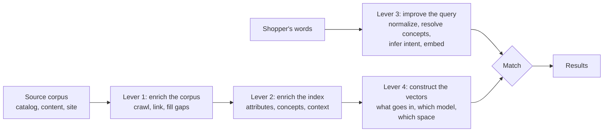

**Figure 1.** Four levers for improving discovery: enrich the corpus, enrich the index, improve the query and construct the vectors. \[[PDF](pathname:///papers/modern-commerce-discovery/figures/figure-01.pdf)\] \[[SVG](pathname:///papers/modern-commerce-discovery/figures/figure-01.svg)\] \[[Mermaid](pathname:///papers/modern-commerce-discovery/figures/figure-01.md)\]

Two of these levers are routinely neglected. The first is enrichment. Tuning the internals of a search engine (boost values, scoring parameters, synonym lists) is brittle and specific to one engine and one corpus. Improving the quality, structure and context of the corpus improves every consumer of it at once, including consumers that have not been built yet. Machine learning amplifies signal; it does not invent it. When in doubt, fix the data and leave the knobs alone. The second neglected lever is the construction of vectors. With lexical search, the corpus is what it is and you tune the algorithm. With vector search you can change how the same corpus is represented and get materially different retrieval without touching the source data. Section 8 comes back to this.

### 1.2 Why now, and why not only because of agents

Start with urgency. As of this writing, autonomous purchasing agents are a small part of commerce traffic. As far as public platform documentation shows, the larger agent platforms mostly rank products from feeds that merchants submit to them rather than calling a merchant's own search (Agentic Commerce Protocol, n.d.). The case made here does not rest on agents. It rests on counterparts that have existed for decades (procurement systems, screen-reading scripts, partner interfaces, feeds, voice lines) and on the roles other than the buyer who also search. Agents are the stress test that makes an old problem hard to ignore.

The story runs in the order a request travels. Sections 2 and 3 ask who is asking. Sections 4 to 8 follow the same mathematics for every seeker, Section 9 asks where the answer lives, Section 10 renders one answer many ways, Section 11 puts policy where it can be replayed, and Sections 12 to 14 turn to learning, conversation and agents. The later sections then ask what should be bought rather than built, how a team would adopt any of this, where the work sits in the literature, and where the argument stops.

## 2 Everyone is a searcher

Commerce discovery is usually designed for one kind of seeker: a buyer, in a browser, looking for a product. I will call anyone or anything that searches a *seeker*, the searcher of the title. The buyer in the browser is the most visible seeker. It is far from the only one.

A seller is searching too, for how its items are found and, more urgently, for where they are lost: "which queries should return my lamp and don't?" An operator searches for problems, opportunities and policy violations, such as the queries that returned results but drew no engagement this week. An advertiser searches for the audiences, contexts and placements where a message fits, say shoppers who are researching home-office lighting. A support agent searches for the fix to someone else's problem ("this lamp flickers on a dimmer"). A supplier searches for how its data is represented downstream, and where its spec sheet is missing or contradicted. And an auditor or regulator searches for evidence that policy was followed: every promoted result shown to accounts of people under eighteen last month.

Every one of those is a search. Each has a request, a corpus, a way of ordering and a set of results, and the request is sometimes an item or an audience rather than text. Several of them are searches in reverse. A seller starts from an item and looks for the queries that ought to find it. An advertiser starts from a message and looks for the contexts it fits. Reverse search is ordinary retrieval with the roles of query and record exchanged, run over a corpus of queries and sessions instead of products. That is not a new idea. Information filtering and information retrieval have been described as two sides of one coin for decades (Belkin & Croft, 1992), and matching stored queries against new documents ships in mainstream engines as "percolation" (Elastic, n.d.). One commerce variant answers a seller's most pressing question directly: search the query log for queries whose intent matches an item but whose result sets omit it. Those are the places where the item is lost.

The roles want different things from the same result. What a seeker is looking for, what the operator or seller wants them to find, and what would be genuinely useful to them are three different sets, and they overlap less than anyone admits. The rule that governs that tension is short to state and hard to keep: the system may rank toward an operator's or a seller's goals, but only through strategies that are declared, attributable and disclosed, and never by changing what is true about an item. Sections 11 and 14 return to that negotiation.

### 2.1 Principal, purpose, counterpart

Any of those roles may be played by a person or by software, and increasingly by both at once. A person may search directly, as a shopper on a phone, a merchandiser in an admin console or a caller on a voice line. Scripted automation searches too, whether it is robotic process automation that fills in forms and reads screens (van der Aalst, Bichler, & Heinzl, 2018), a scheduled integration or a scraper. A language-model agent may be shopping for a person, tuning a seller's listings or triaging an operator's queries. A program may call discovery as a set of typed tools. A feed or an event stream may carry products to a platform. And something not yet invented will arrive, as it always does, before anyone is ready for it.

Three things are easy to blur here, and the rest of the thesis depends on keeping them apart. The first is the *principal*, used in its ordinary principal-agent sense: the person or organization on whose behalf the request is made. When a shopper searches for herself, she is both the principal and the one doing the searching; when an assistant searches for her, she is still the principal. The second is the *purpose*: what the principal is trying to accomplish. The third is the *counterpart*: whatever is actually on the other end of the connection, doing the reading and the writing.

Take a person who asks an assistant to buy a lamp. The person is the principal. "A reading lamp under \$80, here by Friday" is the purpose. The assistant is the counterpart. A merchant's script that updates product copy has all three as well: a principal (the merchant), a purpose (keep the listings current) and a counterpart (the script). When a principal gives a counterpart verifiable authority to act on its behalf within stated limits, I call that authority a *mandate*.

Keeping the three apart gives a division of labor. Policy keys on the principal and the purpose. The computation keys on the request and its declared context. Rendering keys on the counterpart. The division is close to what attribute-based access control already does with attributes of the subject and the environment (Hu et al., 2014), together with the older idea of making purpose a first-class input to access decisions (Byun, Bertino, & Li, 2005). The contribution here is to apply that division to discovery.

## 3 Senses: what the counterpart can perceive and express

What is genuinely useful to a seeker depends on what it can take in and what it can say back. A grid of product thumbnails is excellent for a sighted person on a laptop. It is useless on a voice line. For a script that finds prices by selector or by screen position, it is fragile, because the script breaks the day either one changes.

Rather than building something new for each kind of counterpart, I describe every counterpart with the same four properties. Four is meant as the smallest set in which every property changes something real: each either selects how the answer is rendered or sets a declared parameter of the computation. The first is *modality*, what the counterpart can perceive and how it answers back. The second is its *consideration budget*, how many options it will actually weigh. The third is *turn cost*, what one more question costs it, which folds in whether it can resolve an ambiguity itself. The fourth is *stability need*, how much it depends on the output keeping its shape.

**Table 1.** The minimal counterpart profile: four properties and what each one changes. \[[CSV](pathname:///papers/modern-commerce-discovery/tables/table-01.csv)\] \[[MD](pathname:///papers/modern-commerce-discovery/tables/table-01.md)\]

| Property | Question it answers | What it changes |
|---|---|---|
| Modality | What can it perceive, and how does it answer back? | selects the renderer |
| Consideration budget | How many options will it actually weigh? | a declared parameter: how many results are worth ranking carefully and presenting |
| Turn cost | What does one more question cost, and can it resolve ambiguity itself? | a declared parameter: the threshold between asking a question and showing options |
| Stability need | How much does it depend on the output keeping its shape? | the renderer's contract: free layout, versioned layout, or a published schema |

Here is a sketch of familiar counterparts against those four properties. The values are illustrative, chosen to show the shape of the idea; none of them is measured.

**Table 2.** Familiar counterparts against the four properties. The values are illustrative, not measured. \[[CSV](pathname:///papers/modern-commerce-discovery/tables/table-02.csv)\] \[[MD](pathname:///papers/modern-commerce-discovery/tables/table-02.md)\]

| | Person on the web | Person on voice | Screen-reading script | Language-model agent | Tool-protocol client | Feed consumer |
|---|---|---|---|---|---|---|
| Modality | pixels and text in; clicks and short text out | speech in and out | screen structure in; fixed parameters out | text, structured data or rendered pages in; text and tool calls out | typed records in; typed calls out | records in; acknowledgements out |
| Consideration budget | a few to ten items | one to three | exactly what it was built to read | can read many; measured agents still favor what comes first | the whole response | the whole stream |
| Turn cost | moderate | high to list, low to ask | cannot ask | low (it can ask its principal) | low | none |
| Stability need | low | low | absolute | moderate | contractual (a schema) | contractual |

The point of the table is its shape. A new kind of counterpart should be a new column, not a new search stack. When something nobody planned for arrives, the first question is "what is its profile?" The answer selects a renderer and sets two declared parameters. It does not call for a rewrite. In practice the profile is usually known from the entry point rather than inferred: a storefront, a voice skill, a feed, a partner interface and a tool server each declare their profile by contract. Inference is needed only for the unknown and the unverified.

Two properties that appear in longer lists are deliberately left out. The first is cue literacy, whether a counterpart perceives badges, layout and tone. Under the honesty rule of this thesis, disclosure is data for every counterpart, so nothing important may depend on noticing a visual cue. People miss or misread such cues often enough that relying on them is unwise even for humans (Ofcom, 2016). And some agents do see pixels: in one study, agents that read rendered pages penalized items tagged as sponsored (Allouah et al., 2025), so a badge changes their behavior too. The second property left out is identity, together with mandate. Those are facts about the principal rather than about the counterpart's senses, and they belong to policy.

### 3.1 Profiles are claims; mandates are proof

A counterpart's profile is something it tells you, or something you infer from its behavior. Either way it is a claim. A scraper can present itself as a browser. That is acceptable, because in this design the profile is used only to choose *how to say* something, never *what may be said*.

Proof matters only for the principal and the mandate, because they unlock facts bound to a principal, such as a contract price, an order history or personal data. An unverified counterpart gets the public truth: the same facts and the same disclosure as anyone else, and nothing that belongs to a particular principal. Authenticated agents with mandates exist in early forms. Mandates are specified in the Agent Payments Protocol (Agent Payments Protocol, n.d.), identity linking appears in the Universal Commerce Protocol (Universal Commerce Protocol, n.d.), and signatures for automated clients are being standardized (Meunier & Major, 2026). As of October 2026, production use is limited, and the picture is changing quickly.

A purpose that arrives as free text is a claim as well. Purposes should come from a closed list, bound to the entry point and, for agents, to a verifiable mandate. A purpose selects nothing until it has been matched to that list.


## 4 The contract and the pipeline

Sections 2 and 3 described who might be asking. Sections 4 to 8 describe what happens next. The design goal is that it happens the same way no matter who is asking. The seeker enters only through declared inputs: the request and its constraints, the principal and purpose for policy, and the two parameters drawn from the counterpart's profile.

The phrase "the same math" needs one qualification before I lean on it. People and agents produce different behavioral signals, so a learned ranking model may legitimately be trained and evaluated per family of counterparts (Section 12). What stays the same is the structure of the computation, the facts it may assert and the gates it must pass. The profile may change the form of the answer, the two declared parameters, and which recorded version of a ranking model orders the eligible items. It may never change which items are eligible, what is asserted about them or what is disclosed. The functions are the same for everyone; only their declared inputs differ. Section 10 turns that sentence into a test.

The first design decision is the most consequential. It is a decision about what to assume, and the answer here is as little as possible.

A *store* is a corpus of searchable records. It may be homogeneous, with one schema, which suits faceted navigation best. Or it may be heterogeneous, which is what you need when products, guides, frequently asked questions and policies live together. A *record* is the unit of both search and recommendation: a unique identifier plus a set of *descriptors*, each of which is a name and a value (`brand = Acme`, `scent = chocolate-scent`). And a *result set* is the output of any discovery operation at all:

$$
R = \{\, (\mathit{id}_i,\ s_i,\ D_i) \,\}
$$

where $\mathit{id}_i$ is a unique record identifier, $s_i$ is a score or rank that is present only if the set is ordered, and $D_i$ is the descriptor set of record $i$.

Result sets come in two kinds. Unordered sets, which Boolean retrieval and rules produce, carry identifiers only. Ordered sets carry a score or a rank. That separation is not pedantry. It divides *eligibility* from *relevance*. Eligibility is what may appear, and filters and rules decide it. Relevance is the order in which it appears, and models, context and strategy decide that. Everything after this section depends on keeping the two apart.

Two rules carry the contract. The first is that rankers change scores, never facts. Reranking, blending and personalization may change $s_i$; they may not change $D_i$. Whatever a ranker did, the facts about the item remain the facts the retrieval layer saw. That is what makes reranking safe and explainable. The second rule is one identifier, one canonical record. If a record appears in two result sets, the descriptors they share must agree. That can hold only because each kind of fact has a declared *system of record*, the source that owns it (Section 9). The rule does not hide disagreement between sources. A conflicting claim is carried beside the canonical record as typed, attributed evidence.

The cleanest way to keep both rules in practice is late hydration. Carry only identifiers, scores and traces through retrieval, combination and ranking, and attach descriptors once, at the end, from one store. Volatile facts such as live price and stock are not descriptors in this sense; they are read from their systems of record after ranking, at the points where the system commits to something.

The first rule needs one extension. Merchandising uses pins, reserved slots and sponsored positions, and those are placements rather than changes of score. So the contract includes a *placement step* after ranking: a declared, attributed operation that may move an item to a position, may not change any fact about it, and is disclosed like any other influence.

### 4.1 Three functions with declared inputs

The second decision is to stop treating search as one monolithic call and treat it as three functions. Splitting retrieval from reranking is standard multi-stage practice (Nogueira & Cho, 2019; Liu, 2009); what matters here is what each stage is allowed to depend on.

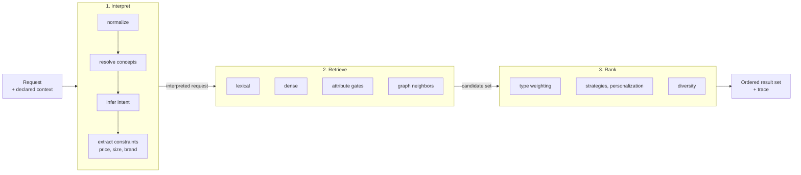

**Figure 2.** Discovery as three functions with declared inputs: interpret, retrieve and rank. \[[PDF](pathname:///papers/modern-commerce-discovery/figures/figure-02.pdf)\] \[[SVG](pathname:///papers/modern-commerce-discovery/figures/figure-02.svg)\] \[[Mermaid](pathname:///papers/modern-commerce-discovery/figures/figure-02.md)\]

*Interpret* turns a raw request into an interpreted one: normalized text, resolved concepts, an inferred intent and extracted constraints, so that "under \$800" becomes a price gate rather than three tokens to match. *Retrieve* answers the question "what is eligible and plausibly relevant?" Its job is to avoid excluding things too early, so it deliberately over-collects across lexical, dense, attribute and graph methods. *Rank* orders that pool by the interpreted request, the context and the declared strategies.

It is tempting to call each phase a pure function, but the accurate claim is narrower. Each phase is a deterministic function of declared, versioned inputs: the request, the context, the index version, the model versions and the configuration. Retrieval against a live index is not pure, because approximate nearest-neighbor results can change when an index is rebuilt. And a hosted language model in the interpret phase may not return the same output twice even with sampling disabled (He & Thinking Machines Lab, 2025). So the claim is determinism given recorded inputs, with model outputs recorded wherever they cannot be reproduced. Section 11 builds on exactly that.

Treating the phases this way still pays off. Each phase can be tested on its own terms, including with property-based tests: normalization should be idempotent, adding a gate should never add results, and a ranking function should return a permutation of its input. Interpretation powers recommendations and analytics as well as search. Several configurations of one phase can run side by side. And a rule-based intent classifier can be swapped for a model without anyone touching retrieval.

### 4.2 Operations over result sets

Once every operation emits the same shape, outputs can be combined, and the combinations look like an algebra. That word promises laws, so I should say which laws hold.

The eligibility layer is a genuine Boolean algebra. Treat unordered result sets as subsets of the set of all record identifiers, and union, intersection and complement relative to that universe satisfy the usual laws: commutativity, associativity, distributivity, the identities of the empty set and the universe, and complement. Applying a gate is intersection with the set the gate admits, so gates commute with each other and adding one can only shrink a result. Policy gates use this part of the vocabulary.

The ordering layer is a family of scoring functions, not an algebra. Fusion combines several ordered lists into one, and a method such as Reciprocal Rank Fusion is a symmetric function of all its inputs at once. Post-rankers change scores on a single list, and they do not commute in general: a boost applied before a diversity cap gives a different order from the same boost applied after it. Three invariants tie the two layers together: every ranking operation preserves the set of identifiers, no operation changes a descriptor, and every score change is attributed (within the limits Section 15 describes for bought engines).

Averaging scores is the wrong merge, and a short example shows why. The tempting rule is to take the mean of a record's scores across two sets and then rescale the whole set to the range zero to one by its minimum and maximum. Consider three scored sets:

$$
\begin{aligned}
A &= \{\, x: 1.0,\ y: 0.5,\ z: 0.0 \,\} \\
B &= \{\, x: 0.5,\ y: 1.0,\ z: 0.0 \,\} \\
C &= \{\, x: 1.0,\ y: 0.0,\ z: 0.5 \,\}
\end{aligned}
$$

$$
\mathrm{merge}(\mathrm{merge}(A, B), C) \;\Rightarrow\; y = 0.333
\qquad
\mathrm{merge}(A, \mathrm{merge}(B, C)) \;\Rightarrow\; y = 0.500
$$

The grouping changes the answer, so the rule is not associative. It has three further faults. It is undefined when every merged score is equal, because the range is zero. It makes every score depend on the extremes of its set. And it can pull down a record that two independent methods both found, when that corroboration should count in the record's favor. Lee (1997) analyzed that reward for documents that several systems return, which is often called the chorus effect. Section 8 says what to use instead.

One more practical fact shapes how these operations actually run. Engines return the top of a list, not the whole set. The intersection of a top-200 search list and a top-200 campaign list can be empty even when thousands of items satisfy both. So intersection, difference against large sets and complement are compiled into retrieval as gates, and operations over materialized lists are used for union and fusion. What this section offers, then, is a Boolean algebra for eligibility, a set of fusion and post-ranking functions for ordering, and three invariants that tie them together. It is a working vocabulary rather than a formal algebra over ordered sets, and that is all the argument needs.

### 4.3 Strategies, attribution and placement

A *post-ranker* takes an ordered result set and returns the same set with different scores. Post-rankers hold personalization, merchandising and business objectives, and they sit logically outside retrieval. Keeping them there keeps retrieval explainable, lets strategies change faster than indexes do, and lets one strategy apply to every surface that uses it: search results, category pages, recommendation carousels, email.

Post-rankers are arranged in *strategy stacks*, ordered and weighted lists of named strategies, such as a semantic boost, an in-stock boost and a concept-affinity score. Each strategy reports its contribution to each item's final score. That attribution is exact when the final score is a weighted sum; with a learned ranker or a nonlinear combination it is an approximation. Stacks can be layered, with a platform default, the operator's own strategies, and overrides per channel. A further tier could learn across many businesses in one industry, but only with enough independent tenants and the contractual right to learn from them. Even then, a pattern learned from tenants is derived from their data, and released data can reveal the records behind it (Narayanan & Shmatikov, 2008). Promoting a learned pattern to a shared tier therefore needs a declared minimum number of independent tenants and a review step.

Where a strategy runs is not a free choice. A strategy whose features are all indexed can be pushed into the engine and run during retrieval; one that needs session context or a live model must run afterwards. Placement looks like a cost optimization, but it changes behavior: an inline boost changes which items reach the candidate window at all, while a post-ranker can only reorder what was already retrieved. Placement is therefore a declared, reviewed property of each strategy, and moving a strategy should trigger a test that its results are still acceptable.

## 5 Everything is a search

Here is the payoff of the contract. If discovery is three functions plus combination plus post-rankers, then most of the separately bought features of a commerce site are the same machine with a different request, a different corpus or a different strategy stack.

Keyword search is the full pipeline over products and content. Type-ahead is a search whose request is a prefix plus the session, over past queries, concepts, categories and products. "Similar items" is dense retrieval with an item as the request. Personal recommendations use a person or segment as the request and rank with affinity post-rankers. Cart cross-sell starts from a basket and walks graph edges, minus what is already in the basket. A category page is an empty text query plus a category gate, ordered only by strategy. Facets aggregate the descriptors of the current result set and then rank the facets as questions, which is the subject of Section 7. Comparison intersects the attributes of two or more items and ranks them by how they differ. "Page not found" recovery treats a dead address as a query. Campaigns and email are collections with a segment and a strategy and no user present. Support is a problem statement against manuals, answers and parts. The seller's "where am I lost?" is reverse search over the query log, the operator's "what is broken?" is aggregation over traces, and the auditor's "was policy followed?" is replay of decision records (Section 11). An agent's tool call is the whole pipeline without the pixels.

The surfaces differ in their requests, their corpora and their strategies; the machinery underneath them is shared.

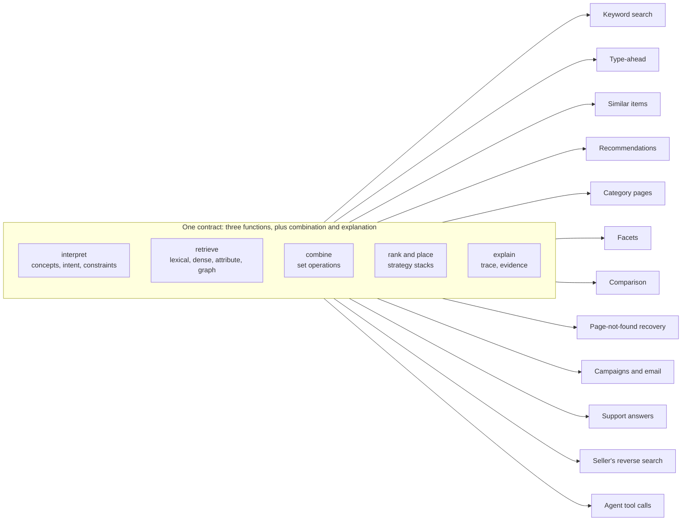

**Figure 3.** Many surfaces, one contract. Each surface uses the same shared functions with a different query, corpus and strategy. \[[PDF](pathname:///papers/modern-commerce-discovery/figures/figure-03.pdf)\] \[[SVG](pathname:///papers/modern-commerce-discovery/figures/figure-03.svg)\] \[[Mermaid](pathname:///papers/modern-commerce-discovery/figures/figure-03.md)\]

"Everything is a search" should be read narrowly. It means that each of those fits the same result-set contract. It does not mean that each uses every phase unmodified, and aggregation over traces and replay of decisions are not searches in the everyday sense. They belong in the list because they emit and consume the same shape, which is what lets one discipline cover all of them. A few deserve more than a sentence.

Reranking is the most valuable feature nobody sells, and it costs almost nothing. Because only the score may change, reranking means applying a new strategy stack to a set you already hold. A shopper rates a result and the page reorders in the session without new retrieval. Intent shifts from browsing to buying and the same pool is reordered. A merchandiser changes a campaign strategy and every surface using it changes at once, traceably. The limit is recall: reranking can only reorder what retrieval returned, so the pool must be deep enough for the intents you expect, or you retrieve again.

Type-ahead is where meaning is cheapest to resolve. Treated as a search rather than a widget, it covers several corpora at once. One is the query log, weighted by whether queries led to engagement rather than by raw frequency, so that popular but failing queries are not promoted. The others are the registry of concepts and the catalog's brands, categories and items. Its results come back segmented because they are, in fact, the union of several result sets. Now suppose a shopper types `choc` and the system offers "chocolate (food)", "chocolate brown (color)" and "chocolate scent". When the shopper picks one, the sense is resolved without any model inference, and the pick is the shopper's own confirmation. That works only for shoppers who use suggestions and understand the labels, so pick rates should be measured before anyone relies on it. Type-ahead can also complete intent rather than words, turning "sneakers" into a structured request such as `[Find] [sneakers] by [Size] [10] [...]`, which is already the first draft of a conversational interface.

Recommendations are searches where someone else wrote the request. Search reflects intent the user declared. Recommendations usually reflect intent the operator inferred or wants. Both produce result sets and both can be blended, but they carry different authority, and careless blending erodes trust. The shopper asked for running shoes, and a page that is half trending headphones because a campaign wants it has stopped listening. Recommended items should be labeled clearly, and paid or promoted items labeled as such. Where a third party pays for placement or a higher ranking, that label is a legal duty rather than a style choice. In the European Union, presenting search results without clearly disclosing paid advertisement or payment for a higher ranking is listed among the practices that are always unfair under the Unfair Commercial Practices Directive as amended in 2019 (European Parliament and Council, 2019, Art. 3(7), inserting Annex I, point 11a). Under the Digital Services Act, online platforms must also label the advertisements they present (European Parliament and Council, 2022, Art. 26). In the United States the Federal Trade Commission treats deceptively formatted advertising as deceptive (Federal Trade Commission, 2016). A merchant's promotion of its own items is not paid placement in that legal sense, though it is still influence, and this design discloses it in the same way.

Seen in sequence, type-ahead, keyword search, recommendations and refinement are one chain of queries through the same three functions, each built from the one before. Type-ahead runs on every keystroke until the shopper picks a suggestion or presses search, and the query at that moment becomes the keyword search. Clicking a result is a query too: the detail page asks for the item and for items related to it, and those related items are the recommendations. Refinement is optional at every step, and it works the same way on the recommendations as on the search: a filter extends whichever query produced the results in front of the shopper.

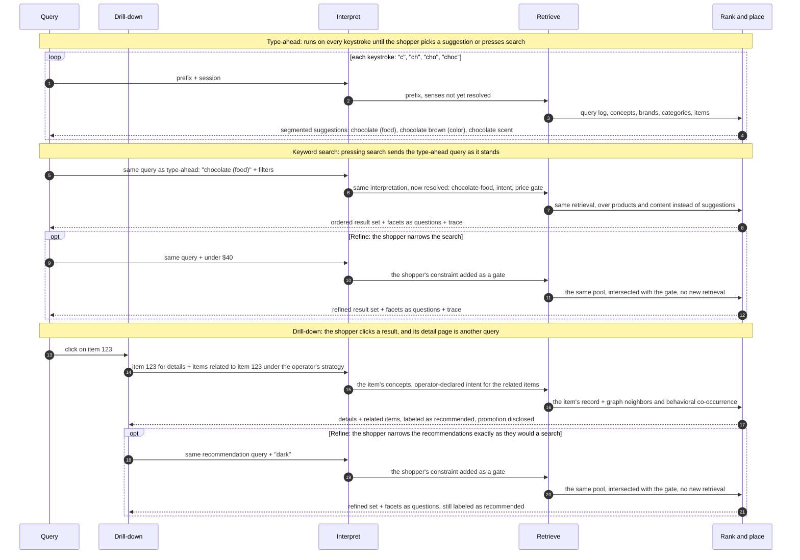

**Figure 4.** Type-ahead, keyword search, drill-down recommendations and optional refinement as one chain of queries through the same three functions. \[[PDF](pathname:///papers/modern-commerce-discovery/figures/figure-04.pdf)\] \[[SVG](pathname:///papers/modern-commerce-discovery/figures/figure-04.svg)\] \[[Mermaid](pathname:///papers/modern-commerce-discovery/figures/figure-04.md)\]

The last exchange is the one most stacks cannot make. Because a recommendation is a result set like any other, a shopper can narrow it by facet, sort it or filter it exactly as they would a search result, and the query then has two authors: the operator whose strategy produced it and the shopper who refined it. The canonical answer records both, so the recommendation label and any promotion disclosure survive the refinement.

Collaborative filtering ("people who bought this bought that") is retrieval over a behavioral graph (Sarwar, Karypis, Konstan, & Riedl, 2001); content-based similarity is dense retrieval from an item vector; "complete the look" is graph traversal. All of them are search, and all of them benefit from the concept resolution, typing and explanation the rest of the system already has. The same goes for the surfaces nobody budgets for. Treat a discontinued product's address as a query: take its terms, run them through discovery, and return the closest matches, related categories and guides. A home-page carousel or the products in a marketing email have no query and often no user, but they are still a result set passed through a strategy stack, so the same strategies govern every collection on the site.

### 5.1 Intent

Intent works at two levels, and it helps to keep them apart. *Query-level intent* classifies a single request by the kind of answer it wants. A useful five-way cut for commerce is learn ("how to choose a TV for a bright room"), shop ("4K TV under \$800"), troubleshoot ("TV flickering randomly"), compare ("OLED vs QLED") and explore ("new laptops"). It is a cut oriented to content types, and it sits beside the classic navigational, informational and transactional taxonomy of web search (Broder, 2002). Its main job is type weighting in the rank phase: learn intent lifts guides, troubleshoot intent lifts manuals and answers, shop intent lifts products, and a cap on each type per page keeps pages from becoming homogeneous. It is cheap, interpretable and practicable as soon as non-product content shares the index.

*Goal-level intent* treats intent as a soft vector that moves during a session. Each goal category (gift, compare, acquire and so on) is scored on a continuous scale, the categories are not exclusive, and they are expected to change:

$$
I(t) \in [0, 1]^n, \qquad S'(t) = f\big(S,\ I(t),\ F,\ C\big)
$$

where $n$ is the number of goal categories, which are not exclusive, $S$ holds the retrieved scores, $F$ the feedback and $C$ the context.

The appeal is that retrieval can be computed once while the ranking follows $I(t)$, so the candidate pool stays put and only the order adapts. That holds only if the turns add no new gates; a turn that applies an age filter shrinks the eligible set. The idea also has two unsolved problems. There is no ground truth for "gift 0.9, compare 0.3", so no estimator can be validated, and the session utility such a vector would optimize has never been defined. Goal-level intent is therefore an aspiration. A practical first version reranks within a session from observable signals (the gates applied, the items viewed, the cart) with no latent vector at all. And any tracking of intent needs care about retention: a passing behavior mislabeled as a lasting preference is how a system recommends a second refrigerator to someone who has just bought one.

## 6 Meaning: concepts, senses and the chocolate problem

Type "chocolate" into most commerce search boxes and you get whatever lexically matches "chocolate". That conflates at least four distinct things. There is chocolate the food, the substance you eat and spill, selected by context words such as recipe, bar, baking, allergy and stain. There is chocolate the flavor, a taste profile derived from the food, as in chocolate protein powder. There is chocolate the scent, an aroma, as in a soy candle, selected by candle, lotion and scented. And there is chocolate the color, a shade of brown, as in chocolate-brown leather boots, selected by sofa, leather and paint. Telling these apart is word sense disambiguation, a mature field in its own right (Navigli, 2009).

A *concept* is a language-independent identifier for one meaning, such as `chocolate-scent`. It carries aliases, labels in several languages, a parent, related concepts and, optionally, an embedding. A query resolves to concepts, each with a confidence. In the example below the confidence values are illustrative; no real resolver produced them.

```json
{
  "query": "vela de chocolate",
  "language": "es",
  "resolved_concepts": [
    { "concept": "candle",          "confidence": 0.94 },
    { "concept": "chocolate-scent", "confidence": 0.87 }
  ]
}
```

The query "how to remove chocolate stains" resolves to the food, the substance on your shirt, not the color. The Spanish query above can retrieve English-language candles without a translation step, provided the concept carries a Spanish label and the embedding space is multilingual (Feng, Yang, Cer, Arivazhagan, & Wang, 2022; Reimers & Gurevych, 2020). It will not work for the long tail of concepts that have no label in the query's language. On the catalog side, every record gets a list of resolved concepts that sits beside its source attributes and never replaces them. Every assignment records the version of the resolver that produced it, so that it can be audited and overridden.

A fair objection comes from the machine-learning side. Contextual models and learned rerankers already resolve sense from context for most multi-word queries, so why keep explicit concepts at all? The answer has two parts. The residual cases are short, ambiguous queries, and type-ahead handles those cheaply. More importantly, the main job of explicit concepts here is not relevance. It is evidence and policy. A ranking model can get "chocolate" right and still be unable to say which chocolate it meant, who asserted that an item contains it, or whether that assertion licenses a conclusion that matters to someone with an allergy. Ranking cannot audit sense. Concepts can.

### 6.1 Is chocolate a food?

Concepts alone are a vocabulary. To reason with them, they need relationships, and in commerce those relationships must be typed. Is chocolate a kind of food? Is milk chocolate a kind of food, or of flavor, or of scent, or of color? The answer is "it depends on which chocolate", and the point of a concept graph is to make "it depends" computable.

A useful commerce graph needs several kinds of edge. A surface term is a *sense of* a concept: the word "chocolate" names `chocolate-scent`, among others. *Is-a* is strict subtyping, where whatever is true of the parent is true of the child: `milk-chocolate-food` is a `chocolate-food`. *Derived-from* means a concept takes its identity from another without being a kind of it: chocolate flavor is derived from chocolate the food. *Evokes* means a perceptual resemblance that implies nothing about composition: chocolate scent evokes chocolate. *Contains* records composition, and it comes in two forms: a definitional fact about a concept, or a fact about one specific product. *Filed-under* records where a merchant's navigation places something, so that a blender can be filed under "Sale" without "Sale" becoming a kind of thing. And *appeals-to* links an item concept to an audience concept.

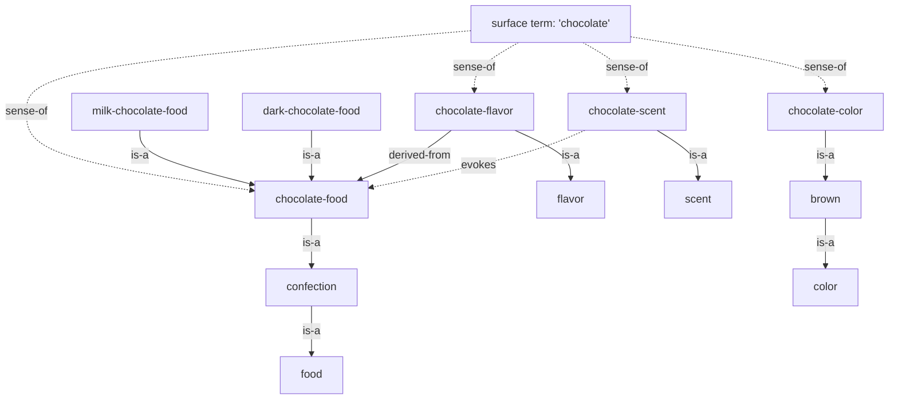

**Figure 5.** Part of a typed concept graph for the word "chocolate": its senses, their is-a relations, and the concepts they derive from or evoke. \[[PDF](pathname:///papers/modern-commerce-discovery/figures/figure-05.pdf)\] \[[SVG](pathname:///papers/modern-commerce-discovery/figures/figure-05.svg)\] \[[Mermaid](pathname:///papers/modern-commerce-discovery/figures/figure-05.md)\]

Read the graph as answers. Chocolate the food is a food; the scent, the color and the flavor are not, since the flavor derives from the food and the scent merely evokes it. Milk chocolate is a subtype of chocolate food and therefore of confection and of food, but "milk chocolate" also names a flavor and a lighter shade of the color: the same two words, three nodes in three hierarchies. Dark chocolate follows the same pattern. In "dark chocolate leather boots" the words name a color, in a "dark chocolate sea salt bar" a food, and in a "dark chocolate protein shake" a flavor. Whether that shake contains any actual dark chocolate is a question for its label.

The distinction between is-a, derived-from and evokes is what keeps a system from telling an allergy-aware agent that a chocolate-scented candle is chocolate. General knowledge graphs have typed relations already (Speer, Chin, & Havasi, 2017). What matters for commerce is that these three are kept apart and never collapsed into one generic "related" edge. The core vocabulary of SKOS, the common standard for taxonomies, has only broader, narrower and related (Miles & Bechhofer, 2009). Taxonomy tools can add custom relation types, but nothing forces them to.

Ontologies also encode choices. Is white chocolate a kind of chocolate? It contains cocoa butter but no non-fat cocoa solids, and some markets regulate it under its own definition (Food and Drug Administration, 2026; European Parliament and Council, 2000, Annex I). Whether `white-chocolate-food` is a `chocolate-food` is a decision, not a discovery. That is why concepts must be versioned, audited and overridable by the business, and never treated as ground truth emitted by a model.

### 6.2 Concept facts and item facts

The most important rule about meaning is this: concept relations describe meanings, item relations describe products, and an item fact must never be inferred from a concept relation that does not license it.

Milk is part of what milk chocolate means, so a product tagged `milk-chocolate-food` may inherit "contains milk". Whether a particular dark chocolate bar contains milk is an item fact. Many do not, some do, and some carry "may contain" warnings; the concept settles none of these cases, and only the label can. A chocolate-scented candle evokes chocolate, which licenses no inference about composition at all. For a person browsing candles, getting this wrong is an embarrassing result. For an agent buying a gift for someone with a cocoa allergy, it is a liability.

The rule has three outcomes, not two. The label says yes, the label says no, or nothing licenses an answer. The third is the common case, because most product records say nothing about composition, and it must be shown as "unknown", never as "no". Allergen statements carry regulatory and liability weight, so a system should quote the label and its source rather than make the claim in its own voice.

### 6.3 Things and audiences

A tempting way to classify concepts mixes three different kinds of thing: properties of items (material, color, scent, place of origin), properties of people (age band, life stage, behavior), and relationships between the two (an eco-conscious brand, a luxury feel). A candle does not have an age band. What it has is an affinity with buyers in an age band. The cleaner model keeps the kinds apart, with plain names: item properties describe things, audience descriptors describe people, and appeals-to edges connect an item concept to an audience concept, each edge with its own evidence and confidence. The separation helps policy as well, because inferring an audience descriptor about a principal is processing personal data, while describing an item is not.

### 6.4 Where the graph comes from

Few teams can hand-build a full concept graph for a large catalog, and they should not try. Governed, human-maintained classifications are standard retail infrastructure, though, so the realistic approach starts from one and lets models propose extensions that people approve.

A governed public taxonomy supplies is-a; GS1's product classification, for example, already distinguishes kinds of milk (GS1, 2026b). The merchant's own site supplies a great deal more. Breadcrumbs, related-product modules, buying guides placed beside categories and structured markup (Schema.org, 2026) all encode the merchant's view of its domain. Breadcrumbs are a curated hierarchy, but a navigational one: "Sale" and "Gifts for Dad" are places, not kinds, so they become filed-under edges and are promoted to is-a only after review. Entity resolution across catalogs is a third source. When the same product appears in several feeds with different descriptions, the variations teach synonyms (Elmagarmid, Ipeirotis, & Verykios, 2007). Global trade item numbers, which cover the UPC, EAN and ISBN-13 formats, are the best anchor when they are present and valid (GS1, 2026a). Models can also learn which attributes differentiate a category and fill them in from descriptions where structured data is silent (Dong et al., 2020). Throughout, models propose and people decide, and every concept, relation and tag carries its source, the job that produced it and a version.

The minimum viable graph is far smaller than Figure 5: a public taxonomy for is-a, the merchant's site for filed-under, and hand-curated evokes and derived-from edges only where confusion is a safety or legal problem, which in practice means food, allergens and materials. The item-fact rule needs no graph at all and can ship first.

One line should be drawn clearly. Learning patterns such as synonyms and salient attributes from aggregated or permissibly obtained data is how the field works. Copying another merchant's original descriptions or images to enrich your own is different: it is likely infringement, and it erodes the trust of the suppliers a business depends on. Bare facts and patterns are not the same thing as original expression.

### 6.5 What kind of thing is this?

A concept tells you what something is *about*. It does not tell you what *kind of thing* it is, and those are different questions. Consider everything that might be about one blender: the product page, the red variant, a bundle with travel cups, the manufacturer's spec sheet, a care manual, an answer to "can I crush ice?", the return policy, a buying guide, a sponsored placement, a customer review, an aggregate rating. Structured-data vocabularies already type content by entity; schema.org has types for products, reviews, ratings, question pages and return policies (Guha, Brickley, & Macbeth, 2016). They rarely separate the other questions a reader of evidence must ask.

So typing has four axes. The *entity type* says what object this is: product, guide, manual, spec sheet, policy, review, advertisement. The *claim type* says what kind of statement it makes: a specification, an instruction, a commitment (price, policy, warranty), an opinion, an aggregate opinion, or persuasion. The *source* says who is saying it: the manufacturer, the merchant, a customer, an independent party, a regulator, or a machine. And *validity* says when and where it is true.

The axes matter because evidence is not interchangeable. "This blender crushes ice like a champ" is a customer's opinion. "1,200 W motor, ice-crush rated" is the manufacturer's specification. Both answer "can it crush ice?", but they are different kinds of evidence and should not be ranked or quoted as if they were the same. An advertisement is content written to make you want a product. That is fine, since commerce runs on it, but the advertisement must stay labeled as persuasion. The label matters most when the reader is an agent that may never see the visual cue a person uses to discount it. "Free returns within 30 days" is a commitment, made by someone, valid until some date, and an agent completing a purchase needs to know all three.

Requiring all four axes on every record is not practicable, so the workable form is weaker. Entity type and source are required, because the source system (product information, content management, reviews, the ad server) almost always knows them. Claim type belongs to passages rather than whole documents, because one product page holds specifications, persuasion and commitments side by side. It defaults from source and entity type (a spec sheet means specification, a review means opinion, an ad means persuasion, a policy means commitment), and where it matters a classifier refines it, with its outputs recorded. Validity is required for commitments. And "unknown" is a value the system stores, shows and reasons about, never a gap filled with a guess.

Typing earns its keep internally before any outside consumer reads it. It lets intent be matched to type, so that a troubleshooting query surfaces the manual instead of three more blenders. It keeps opinion apart from specification. And it protects a business's own summaries from laundering persuasion into neutral-sounding fact. "Sponsored" in particular must arrive as data from the ad or merchandising system, because it cannot be recovered reliably from the content afterwards.

## 7 Facets are questions

Section 5 listed facets as one more surface that the contract makes cheap: aggregate the descriptors of the current result set, then rank the facets. Facets deserve a section of their own, because with the right interface facets stop being a sidebar of checkboxes and become a conversation in which the system asks the questions and the shopper answers by clicking.

A facet is a descriptor whose values partition the current result set, shown with counts: *Screen size: 43" (200), 55" (300), 65" (300), 75" (200).* Read it aloud and it is a question, *what size do you want?* The values are the possible answers. The counts tell the shopper how many options each answer will leave, and they promise that no answer leads to an empty room. Selecting a value turns it into a gate, and the next facets are computed from what remains. Each click is a turn. A shopper who chooses a size, then a panel type, then a price, then a brand has had a four-turn conversation with the store.

The interface decides whether anyone notices. The same facet logic rendered as a sidebar of every facet and every value feels like a form, with every question asked at once. Rendered as a short ranked list, best first, it feels like a store that knows what matters for this query. One facet at a time, full width, with a skip, it is a guided-selling interview. Chips above the results are suggested replies. And a structured request such as `[Find] [sneakers] by [Size] [10] [...]` is a sentence the shopper builds with the system's help. The machinery underneath all five is identical. Faceted search with the right interface is guided search, a reading that follows the faceted-search literature (Yee, Swearingen, Li, & Hearst, 2003; Hearst, 2006, 2009; Tunkelang, 2009).

If facets are questions, the central design problem is the one every good salesperson solves without thinking: which question next? Treating facet choice as question selection is an established idea. Basu Roy and colleagues chose facets to minimize the expected effort of reaching an item (Basu Roy, Wang, Das, Nambiar, & Mohania, 2008). Facet ranking has been personalized (Koren, Zhang, & Liu, 2008) and studied for product search (Vandic, Frasincar, & Kaymak, 2013; Vandic, Aanen, Frasincar, & Kaymak, 2017). Product-search systems have selected questions sequentially by their expected information (Zou & Kanoulas, 2019), asked about aspect values (Zhang, Chen, Ai, Yang, & Croft, 2018), and generated clarifying questions from query facets (Zamani, Dumais, Craswell, Bennett, & Lueck, 2020). What this section adds is a checkable, interpretable form of the idea. It is a score built from usage, coverage, information gain and path, with its preconditions, biases and sensitivity stated, and it is offered as a baseline that learned question policies should have to beat.

### 7.1 Which question next: information gain

Start with how well a facet splits what is left. Over the current result set $R$, a facet $F$ with values $v$ and counts $n_v$ has a value distribution $p(v) = n_v / |R|$ and an entropy (Shannon, 1948):

$$
H(F) = -\sum_{v} p(v)\, \log_2 p(v) \quad \text{(bits)}
$$

Entropy is highest when a facet has many evenly populated values and zero when every item shares one value. Under two conditions it has a precise reading here. If every item in $R$ is equally likely to be the one the shopper wants, and every item carries exactly one value of the facet so that the counts partition $R$, then the chance the shopper answers $v$ is $n_v / |R|$, and the expected information the answer gives about which item they want is exactly the facet's entropy:

$$
\mathrm{IG}(F) = \log_2 |R| - \sum_{v} p(v)\, \log_2 n_v = H(F)
$$

When those conditions hold, the facet with the highest entropy is the question that narrows the field most on average, the logic of a good opening move in Twenty Questions. Both conditions often fail. A multi-valued facet, such as color when an item comes in several colors, makes the counts sum to more than $|R|$, so $p$ is no longer a distribution and the identity breaks. Such a facet is better scored as a set of yes-or-no splits, one per value. And shoppers are not uniform. If shoppers in this context answer $v$ with observed probability $q(v)$, the quantity $\log_2 |R| - \sum_{v} q(v)\, \log_2 n_v$ is the expected log-reduction in the size of the candidate set. That is a useful score, an expected log-narrowing, but it is not Shannon information about the target. It still captures the right intuition: a facet whose popular answers leave large remainders is a weaker question than its entropy suggests.

There is a known bias here, and the decision-tree literature named it long ago. Information gain toward a class label is the splitting rule of decision-tree induction (Quinlan, 1986). The entropy of an attribute's own value distribution is what C4.5 calls *split information*, and tree learners divide by it precisely because raw gain favors attributes with many values (Quinlan, 1993). The same bias appears in the example below, where brand, with ten values, outscores screen size on entropy alone. The frequency term is the corrective.

Two practical rules follow. First, clean the values before counting them. Entropy counts distinct values, so a screen-size facet stored as `65in`, `65"` and `65 inch` looks more informative than its clean version, and without normalization the score prefers the messiest facets. Second, choose numeric buckets by quantile. For $k$ buckets, entropy over item counts is greatest when each bucket holds the same number of items, so price ranges cut at quantiles of the current result set, then rounded to boundaries people can read, ask a much better question than fixed ranges do when everything in the set costs about the same.

### 7.2 Which question next: frequency, coverage and path

Information gain alone asks bad questions. It will happily ask a shopper browsing televisions how many HDMI 2.1 ports they need, because that facet happens to split the catalog evenly. A good question must also be one that people can and will answer. Three further ideas capture that. *Frequency of use*, $u(F \mid \mathit{path}, \mathit{context})$, is how often shoppers in this context engage the facet when it is offered, the best available proxy for "do people care, and do they know the answer?" *Coverage*, $c(F)$, is the fraction of the result set that carries the facet at all; a beautifully balanced facet present on 20% of items silently drops the other 80% when it is chosen. And *path* is where the shopper already is, because frequency depends on what has already been asked. One simple combination is:

$$
\mathrm{score}(F \mid R, \mathit{path}, \mathit{context}) = u(F \mid \mathit{path}, \mathit{context}) \cdot c(F) \cdot \mathrm{IG}(F \mid R)
$$

This is a heuristic, not a derivation. A decision-theoretic version would look more like the probability of an answer times the expected narrowing, divided by the cost of answering. I use the product form because each of its terms can be read and checked. It comes with two caveats. The first is a feedback loop in the frequency term. Because $u$ is estimated only from facets that were shown, and partly from where they were shown, a facet that is never offered never earns a frequency, so $u$ should be smoothed toward a prior for the category, with a small share of impressions reserved for exploration. The second is that the convention for missing values must be stated. Here entropy is computed over the items that carry the facet, and coverage enters as a separate factor. Ordering facets by how shoppers use them is already sold commercially (Section 15). The entropy, coverage and path terms are the refinement.

Here is a worked example, with invented numbers chosen only to show the arithmetic. The query is "tv", and 1,000 televisions match.

**Table 3.** Facet scores for the query "tv". A worked example with invented numbers. \[[CSV](pathname:///papers/modern-commerce-discovery/tables/table-03.csv)\] \[[MD](pathname:///papers/modern-commerce-discovery/tables/table-03.md)\]

| Facet | Values (counts) | $H$ (bits) | $u$ | $c$ | score |
|---|---|---|---|---|---|
| Screen size | 43 (200), 55 (300), 65 (300), 75 (200) | 1.97 | 0.45 | 1.0 | **0.89** |
| Brand | two brands at 400 each, eight at 25 each | 2.12 | 0.30 | 1.0 | 0.64 |
| Panel type | OLED (150), LED/QLED (850) | 0.61 | 0.15 | 1.0 | 0.09 |
| HDMI 2.1 ports | 0, 1, 2, 4 (150 each; 600 items list it) | 2.00 | 0.02 | 0.6 | 0.02 |

Pure entropy would open with brand and rank HDMI ports above screen size. The combined score opens with size and puts HDMI ports at the bottom, where they belong. Now the shopper picks 65", and three hundred televisions remain. The counts have to stay consistent with the whole catalog, so here the two large brands contribute 130 sets each and the eight small brands 5 each, and 120 of the 150 OLED sets are 65".

**Table 4.** Facet scores within 65-inch televisions, once size has been chosen. Invented numbers, continuing the example. \[[CSV](pathname:///papers/modern-commerce-discovery/tables/table-04.csv)\] \[[MD](pathname:///papers/modern-commerce-discovery/tables/table-04.md)\]

| Facet (within 65") | Values (counts) | $H$ (bits) | $u$, given size chosen | score |
|---|---|---|---|---|
| Panel type | OLED (120), LED/QLED (180) | 0.97 | 0.45 | **0.44** |
| Brand | two at 130 each, eight at 5 each | 1.83 | 0.20 | 0.37 |

Panel type, a poor opening question, is now the best second one. The remaining set is split more evenly, and the path says that people who have settled on size go to panel type next. But the ordering is sensitive. If shoppers who chose a size moved to brand with frequency 0.25 instead of 0.20, brand would score 0.46 and edge out panel type. That sensitivity is the real lesson of the example. The frequency term carries much of the decision, so it has to be measured rather than guessed.

Paths come from three places. Learned paths come from clickstream sequences of facet choices that ended well, in an add to cart, a purchase or a long look at a product page. Because such data is sparse, a first-order model (the next facet given the last one) is a reasonable default, with back-off to the parent category in the long tail. Guessed paths cover the cold start of a new category or a rare query, and the merchant's own site is the first guess: a buying guide that says "first decide on size, then on panel technology" is a path, written down. Blended paths start from the guess and shift toward learned frequencies as evidence accumulates.

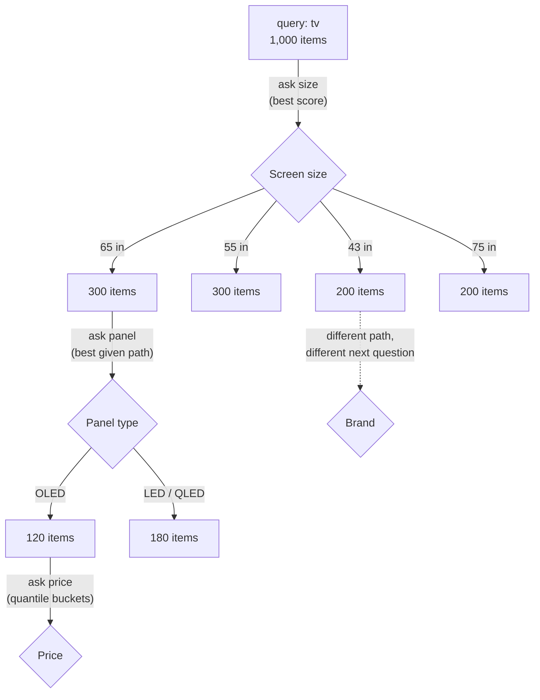

**Figure 6.** Guided search over televisions. Each answer narrows the set, and the next question is chosen for the path the shopper is on. \[[PDF](pathname:///papers/modern-commerce-discovery/figures/figure-06.pdf)\] \[[SVG](pathname:///papers/modern-commerce-discovery/figures/figure-06.svg)\] \[[Mermaid](pathname:///papers/modern-commerce-discovery/figures/figure-06.md)\]

### 7.3 A choose-your-own-adventure conversation

Put the pieces together and look at what guided search is. The system asks a question. The shopper picks one of a fixed set of answers. The next question depends on the answer. The shopper chooses the path, but every page on every path was written in advance. That is a choose-your-own-adventure book. It simulates conversational selling without a language model: the conversation is prescripted, but the script is generated from facets, information gain and observed paths rather than written by hand.

Scripted conversation has real strengths, worth naming because the unscripted kind tends to lose them. It is grounded by construction, because every answer on offer is a facet value that exists, with a count; the shopper cannot ask for something the catalog does not have, and the system cannot promise it. It has no dead ends, provided counts are exact and zero-count values are hidden. Counts are not always exact, though: sharded engines do not always guarantee them, and they drift if live stock is applied as a gate after retrieval. It explains itself, because the path is the explanation: you are seeing these because you chose 65", OLED and under \$1,500. It is cheap, an aggregation per turn rather than a model inference. And it is measurable, because every question has an observable outcome: answered, skipped, undone, or followed by a purchase.

Its limits are just as real. It can ask only the questions it has, and "something cozy for a cabin" has no facet. Its answers are closed, so "big, but it has to fit a 60-inch alcove" cannot be said. It takes one answer per turn, so a shopper who knows exactly what they want ("65-inch OLED under \$1,500") must click three times to say one sentence. And it has no page for a follow-up its author did not anticipate, such as "wait, what is the difference between OLED and QLED?"

### 7.4 What language changes, and what it does not

A language model removes the script. The shopper can say anything, in any order, with several constraints at once. It does not remove the need for what was underneath the script. I recommend guided search with a language front end, and I offer that as a position rather than a measured result. The facet policy decides *what* to ask. The language layer decides *how* to ask it. And every constraint the language layer interprets is checked against counts before the system relies on it, so that when nothing matches, the system says so and offers the closest thing rather than promising what does not exist. That direction is consistent with the clarifying-question literature (Aliannejadi, Zamani, Crestani, & Croft, 2019; Zamani et al., 2020; Zhang et al., 2018).

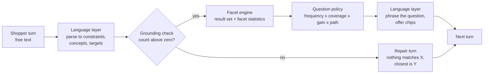

**Figure 7.** A language layer over the facet machinery. The model parses and phrases; counts, gates and grounding stay underneath. \[[PDF](pathname:///papers/modern-commerce-discovery/figures/figure-07.pdf)\] \[[SVG](pathname:///papers/modern-commerce-discovery/figures/figure-07.svg)\] \[[Mermaid](pathname:///papers/modern-commerce-discovery/figures/figure-07.md)\]

The script did not go away. It went underneath. Facet counts become the check on what a conversation may promise, the question score becomes the way to decide which clarifying question is worth a turn, and the old chips become suggested replies. The measure "was that a good question?" carries over unchanged when a language model does the phrasing, which is one more reason to keep the policy separate from the phrasing. Guided search therefore deserves to be designed, instrumented and evaluated as a dialogue policy rather than treated as navigation plumbing, so that a language model has a policy to plug into instead of a sidebar to replace.

## 8 Vector search is spatial search

Say "vector search" in a meeting today and nearly everyone hears "embed text with a language model and find the nearest neighbors". That is one vector search. It is not the definition.

A vector is a list of numbers, which is to say a position in a space, and vector search asks what is near a position under some notion of distance. Everything interesting lives in two choices: what the dimensions mean and what distance means. Language-model embeddings are one recent, powerful answer to both, but not the first. The first was keyword search itself. Salton, Wong and Yang (1975) described documents as vectors with one dimension per vocabulary term, weighted by how characteristic each term is, and relevance as the angle between query and document vectors. That is the vector space model, and the weighting that makes rare terms count for more is older still (Spärck Jones, 1972). BM25 comes from a different tradition, the probabilistic relevance framework (Robertson & Zaragoza, 2009), but it can be computed in the same form, as a sum over the query's terms of a query weight times a document weight: a dot product between two very sparse vectors. The inverted index is the structure that makes that dot product fast when almost every dimension is zero (Zobel & Moffat, 2006).

So "keyword versus vector" is a false opposition. Lexical vectors have one readable dimension per term and are searched exactly through an inverted index. Learned sparse vectors keep one dimension per term but learn the weights, including weights for terms the text never used (Formal, Piwowarski, & Clinchant, 2021). Dense language vectors have a few hundred to a few thousand dimensions that no person can read individually, and are searched approximately, usually through a graph such as HNSW (Malkov & Yashunin, 2020). All three are vector search. They differ in sparsity, in whether a dimension can be read, and in whether retrieval is exact or approximate.

Once a vector is understood as a position, commerce turns out to be full of spaces, most of them low-dimensional, most of them older than language models, and many already searched by nearness without anyone calling it vector search. There is a concept space, where items are near if they share concepts. There is geography, where "which stores, stock or sellers are near me?" is answered by great-circle distance and has been served for decades by tree and grid structures (Bentley, 1975; Guttman, 1984) with no language model in sight. There is color, where a perceptual space such as CIELAB (International Organization for Standardization & International Commission on Illumination, 2019) was designed so that equal distances look like roughly equal differences, and later difference formulas exist because "roughly" matters (Sharma, Wu, & Dalal, 2005). There is physical fit ("what fits a 60 cm opening?"), price and other quantities ("about \$40"), time ("arrives by Friday") and images ("looks like this photo", where images and text can share a space; Radford et al., 2021). And there is behavior: matrix-factorization recommenders place users and items in one latent space and recommend by dot product (Koren, Bell, & Volinsky, 2009), which is vector search by any reasonable definition.

Thinking spatially buys three things. It replaces match with nearness: "about \$40" is a target, not a range, and a \$42 item is nearer than a \$25 one, which a filter cannot say. It fails gracefully. When nothing matches exactly, something is still nearest, and "nothing in that exact shade; these three are closest" beats an empty page. The observation of Section 1.1 still stands, though: the engine cannot return what is not there. And facets can take positions as answers, so the shopper can answer a question with "this shade", "about this size" or "near this store", and the system ranks by distance.

It also moves the design work into the space. A price space in which \$10 and \$20 are as far apart as \$1,000 and \$1,010 is the wrong space for most catalogs, where relative or logarithmic distance usually fits better. A color space built on raw red, green and blue values will call colors close that people see as different. Language embeddings are not exempt: a space that puts "chocolate scent" next to "chocolate brown" has a distance that does not mean what the shopper meant. Whose distance counts is a real question. By default it is learned per category, but distance is also a preference, so a principal may declare an override ("closer in color matters more to me than closer in price"), and that override is a declared parameter like any other.

### 8.1 Vectors are built, not found

How a vector is built is a lever available even when the catalog does not change, and three choices matter. The first is the text you embed, which is a design decision. One workable approach flattens every record into a consistent `attribute=value;` string before encoding, so that the model sees the same structure across suppliers and an ice maker is not buried in the eleventh sentence of a description. A close published relative serializes entity records in a similar way (Li, Li, Suhara, Doan, & Tan, 2020). Encoders read a limited number of tokens, so the string should be ordered by importance rather than alphabetically, with the long description last, and checked for truncation. Context can go into the string as well: the breadcrumb path, the document type, the concepts inherited from neighboring pages, so that a washer filed under front-load machines carries "front-load" even if the supplier forgot to say so.

The second choice is whether to embed senses. The hypothesis, still to be tested, is that embedding readable sense-tagged strings such as `scent=chocolate-scent` beside the surface words will separate the scent from the color in the space itself. Readable tags plausibly work with general encoders; opaque identifiers would need a trained model.

The third choice is how many vectors an item gets. Several vectors per item (title, description, concepts, perhaps one per facet with queries routed by concept) let an item have several kinds of similarity instead of forcing one vector to pick. Per-field vectors are only loosely related to token-level late interaction (Khattab & Zaharia, 2020; Santhanam, Khattab, Saad-Falcon, Potts, & Zaharia, 2022), since they choose among vectors by field rather than letting tokens interact. Every extra vector costs storage, another retrieval, another weight to tune and a full re-embedding of the catalog whenever the encoder changes, so a vector should be added when measurement says it pays for itself.

Choosing an encoder is an empirical and economic question, and the families change quickly: contrastively fine-tuned sentence encoders (Reimers & Gurevych, 2019), dense passage retrievers (Karpukhin et al., 2020), learned sparse encoders (Formal et al., 2021), late-interaction models (Khattab & Zaharia, 2020), embedders built on large language models, and embedders trained so that their vectors can be truncated (Kusupati et al., 2022). As of October 2026, fine-tuned sentence encoders remain a reasonable cost-conscious default, which is a judgment about cost rather than a ranking of quality. Benchmarks show that no single retriever wins everywhere and that BM25 remains a strong baseline (Thakur, Reimers, Rücklé, Srivastava, & Gurevych, 2021). The right answer for a given catalog is found by testing against its own judged queries rather than by reading tables. Buying a managed product can remove this lever entirely, because the vendor chooses what is embedded, a trade-off Section 15 returns to.

### 8.2 Hybrid search is any blend of mechanics

In common industry usage, "hybrid search" means lexical plus dense retrieval, fused. I use a wider definition. A *mechanic* is any single way of finding or ordering things: a Boolean filter, lexical scoring, nearest-neighbor search in some space, graph traversal, a business rule, a learned model. *Hybrid search* is any search that blends two or more mechanics. By that definition nearly every commerce search worth using has been hybrid for a long time. Classic faceted search blends Boolean filters with lexical scoring. "Running shoes near me, in stock" blends lexical relevance, geographic nearness and an availability filter. Search with merchandising rules blends retrieval with boosts and pins. Learning to rank takes any of these as features (Liu, 2009; Burges, 2010).

The wider term earns its place because it exposes a distinction that the narrow term hides, and confusing the two sides of that distinction is the most common hybrid mistake. *Gates* are predicates: in stock, ships to this postcode, price at most \$40, contains no milk according to the item's own data. An item passes or it does not, and a selected facet value is a gate the shopper chose. *Gradients* are scores: lexical relevance, nearness in any space, behavioral affinity, strategy boosts. More is better and less is worse, but nothing is excluded. A gate must never be implemented as a gradient. An out-of-stock item that sits very close in the language space is still out of stock, and a candle that is semantically near "dark chocolate" still contains no chocolate. Nearness can rank. Only gates can exclude.

With that distinction in hand there are a handful of ways to blend. Gate, then rank: gates define the eligible set and gradients order it, which suits hard constraints, though heavy gating can starve approximate dense retrieval of candidates. Cascade: a cheap mechanic retrieves many and an expensive one reorders few, with the risk that whatever the first stage misses is lost. Parallel fusion: several mechanics retrieve independently and the results are combined, which needs the arithmetic below. Joint space: several spaces concatenated and searched once. And learned blends, where each mechanic's output is a feature for a learned ranker, which needs labels or trustworthy signals. Real systems stack these: they gate on availability and tenant, retrieve in parallel from lexical and language spaces, fuse, and then cascade into post-rankers. No single retriever wins every query, either. Model numbers and brand names want exact lexical match, vague and descriptive queries lean on dense retrieval, and long-tail and multilingual queries benefit from several layers. Classifying queries and choosing a strategy per class is therefore itself a blend, and its starting weights are placeholders to tune rather than findings.

### 8.3 A multi-vector search is already a hybrid search

Searching two vectors of one item at once blends two mechanics, so a multi-vector search is a hybrid. The converse also holds, and the arithmetic is short. Take $k$ spaces. Normalize each item vector $d_i$ and each query vector $q_i$ to unit length, choose a weight $w_i$ per space, and concatenate:

$$
\begin{aligned}
Q &= [\, w_1 q_1,\ w_2 q_2,\ \dots,\ w_k q_k \,] && \text{weights on the query side} \\
D &= [\, d_1,\ d_2,\ \dots,\ d_k \,] && \text{item vectors, unweighted} \\
Q \cdot D &= \sum_{i} w_i\, (q_i \cdot d_i) = \sum_{i} w_i \cos(q_i, d_i)
\end{aligned}
$$

One dot product over the concatenation equals a weighted sum of per-space cosines. This is a standard observation in hybrid indexing, where hybrid vectors are defined as concatenations (Bruch, Nardini, Ingber, & Liberty, 2024) and sparse and dense scores are commonly combined by a weighted sum (Luan, Eisenstein, Toutanova, & Collins, 2021). It is applied here to the heterogeneous spaces of commerce, and it has preconditions. The identity, and the claim that ranking by this dot product agrees with ranking by cosine, both need every item to have every block and every block to be unit-normalized on both sides. An item missing a block (no image, no description) gets a zero vector there, so its norm differs, and a cosine of zero for that block is scored as evidence of dissimilarity when it really means absence. The policy for missing blocks must therefore be declared. Unit normalization also discards magnitude, so a unit-normalized lexical block is cosine-weighted term matching, not BM25.

It is tempting to add geography as one more block. Latitude $\varphi$ and longitude $\lambda$ map exactly to a point on the unit sphere, $(\cos\varphi \cos\lambda,\ \cos\varphi \sin\lambda,\ \sin\varphi)$, and the dot product of two such points is the cosine of the angle between them, which falls as great-circle distance grows. On paper, "near me" becomes one more block. In practice the similarity is almost flat at the distances that matter. For points $d$ kilometers apart on a sphere of radius 6,371 km, $1 - \cos\theta$ is about $\theta^2/2$, which works out to about 1.2e-8 at 1 km, 4.9e-8 at 2 km, 3.1e-7 at 5 km, 1.2e-6 at 10 km and 1.2e-4 at 100 km. The spacing between 32-bit floating-point numbers just below 1 is about 6e-8. So in 32-bit arithmetic, stores within about 2 km are numerically indistinguishable from each other; at 5 km the signal is about five units in the last place, and across 10 km about twenty. Even in 64-bit arithmetic the whole block moves by about one part in a million across 10 km, so its weight would have to be enormous to register at all, and it would then swamp every other block at long range. A weighted sum of cosines is the wrong shape for a local, bounded idea like "near me". That idea is usually served as a gate (a radius or a delivery zone) or as a distance kernel applied as a separate mechanic and fused. The identity describes what a fused answer *means*; it does not say geography should be served that way.

Two consequences of the identity do hold. The weights are the strategy: because they sit on the query side, one index serves any blend, and a conversational turn that reveals "it has to be this shade" can raise the color weight without touching the index. And index structures still differ, since sparse, dense and geographic blocks are usually served from different structures and fused, which brings us to the arithmetic of fusion.

### 8.4 Fusion arithmetic

Parallel fusion needs arithmetic, and the choice is empirical. Raw scores do not share a scale: a BM25 score of 12 and a cosine of 0.83 are not comparable, and min-max normalization makes each list depend on its own extremes. Rank fusion avoids the problem of scale by discarding magnitude. Reciprocal Rank Fusion scores each item by $\sum_{m} \frac{1}{k + \mathrm{rank}_m}$ across mechanics $m$, with the constant $k = 60$ fixed in a pilot (Cormack, Clarke, & Büttcher, 2009). It rewards items that several mechanics rank well, which is the corroboration that a mean can destroy, and it needs no calibration. The cost is twofold. A lexical hit with an enormous margin counts the same as a marginal first place. And standard rank fusion is unweighted, so the idea that weights are the strategy needs a weighted variant.

Rank fusion is a good default, not the best possible answer. Bruch, Gai and Ingber (2023) compared fusion functions for lexical plus dense retrieval and found Reciprocal Rank Fusion sensitive to its parameters. A convex combination of normalized scores, with one weight tuned on a small labeled sample, outperformed it both in-domain and out-of-domain, and the choice of normalization mattered less than expected. That study covered two retrievers. Calibration is the other path: converting each mechanic's score to a probability of relevance makes a weighted sum mean something, at the cost of maintaining the calibration as catalogs and models change. The position here is narrow. The mean followed by min-max rescaling is a weak default, for the reasons in Section 4. Rank fusion is a strong baseline that needs no tuning. With some judged data a tuned weighted combination may do better, and an evaluation harness (Section 12) is what decides.

---

## 9 Where does the lamp live?

Ask a commerce system about a reading lamp. Where should it look? The product catalog knows what the lamp is, its attributes and its variants. The content repository holds the guide to desk lighting, the assembly instructions and the photographs. Inventory and order systems know whether it is in stock, where, how fast it can arrive and at what price right now. The reviews system holds what customers think. The merchant's own site encodes relationships in its structure. Partners and marketplaces may offer the same lamp. The principal's own context, the lamps already in their home office, is relevant too, with consent. And the open web has independent reviews, recalls and the manufacturer's own pages.

Every one of those is a legitimate answer to "where is the lamp?", and none of them is sufficient. A genuinely useful answer to "is this lamp good for a home office, and can I have it by Friday?" draws on at least four.

The way through is to stop asking which *system* holds the lamp and start asking which system is the system of record for each *kind of fact* about it. Specifications come from the manufacturer, through the product catalog, and change slowly. Instructions for choosing, installing and caring for it come from the content repository, and are versioned. Price comes from the pricing system and changes quickly; it is a commitment, with a period of validity. Availability and the delivery promise come from inventory and order systems and change very quickly; they are commitments too. What customers think comes from the reviews system and is opinion, individual or aggregated. Recalls and safety notices come from the regulator or the manufacturer, arrive on events, and override almost everything else. What the principal owns or prefers comes from the principal's own data and is usable only within consent and purpose. And what the open web says comes from third parties, is uncontrolled, and is never treated as an instruction. This is ordinary master-data practice applied to discovery, and its consequence is simple: no fact is borrowed from a source that is not its system of record.

### 9.1 Volatile facts: two tiers

Price and stock change faster than most indexes refresh, and it might seem to follow that they should never be indexed. That goes too far. Gating on live stock after retrieval starves the top of the list and makes facet counts dishonest, and calling inventory for every candidate on every request is a fan-out that inventory services are rarely sized for.

The workable pattern has two tiers. Indexed, near-real-time availability and price are used for retrieval, gating and facet counts. An indexed "in stock" is a recent report: good enough to filter and count by, not good enough to promise. The promise comes from the second tier. At every point where the system commits to something (the product page, the cart, a quote to an agent, checkout), it reads the system of record, and only for the items actually shown. Until that read, the index is repeating a rumor; the read is what turns it into a statement the business can stand behind.

### 9.2 Conflicts are evidence

When the manufacturer says 800 lumens and a reviewer measured 600, the useful answer carries both, typed and attributed, rather than silently choosing one. Probabilistic knowledge fusion makes the same point at web scale: facts come with confidence, not certainty (Dong et al., 2014). This is how the contract's rule of one identifier, one canonical record coexists with disagreement. The canonical record holds the value from the system of record, and conflicting claims sit beside it as typed evidence. Agents in particular will want to see the disagreement.

### 9.3 The open web

General web search is a source like any other, with a distinctive profile: broad, uncontrolled, unlicensed by default, and full of text written to influence. It earns its place in two situations. One is the absence case from Section 1, where the honest and useful answer may be "we don't sell that; here is what it is and what to look for". The other is learn intent, where independent explanation is worth more than the merchant's own. As a source of facts about the merchant's own items, though, it is dangerous. Everything from the open web is typed as a third-party claim, and none of it is ever treated as an instruction (Section 14).

### 9.4 The merchant already told you

Product feeds give titles, prices and some attributes. They do not carry the hundreds of editorial decisions that make a site coherent: which category a product sits in, which products are shown as alternatives or accessories, which buying guide sits beside which category, how addresses such as `/4k-tv/120hz/gaming` encode attributes, which items are grouped into "gifts for travelers". Those decisions are the merchant's own model of its domain, and that model is sitting there, published. Commercial site crawlers commonly extract text and fields. In my judgment, which rests on no measurement, few use the navigation as part of the model of meaning.

Indexing content with its position in the site lets a buying guide filed under televisions be recognized as relevant both to learn-intent queries and to a guided flow narrowing between panel types. The practicable form is modest. Crawl a short list of page types (category, product, guide). Extract only structured markup, breadcrumbs and related-product modules, and store them as filed-under and linked-from edges. Respect robots exclusions, rate-limit, identify the crawler, and avoid the crawler traps that faceted navigation creates.

### 9.5 Never overwrite the source

Ingestion rests on one principle and a few consequences. The principle is that source attributes are preserved unmodified, and that concepts, embeddings and inferred facets are derived enrichments that sit beside them. When an enrichment is wrong, and sometimes it will be, anyone can see exactly what the supplier said and exactly what a model added. That needs a precedence rule for display, which says what the page shows when the supplier is silent and a model inferred a value, and how that value is labeled. Every enriched field carries a confidence and the version of the model that produced it, with provenance recorded in a standard vocabulary where that helps (Lebo, Sahoo, & McGuinness, 2013). Concepts are versioned, audited and overridable. New fields from new sources are kept as provisional rather than rejected, and promoted when use justifies it. And in a platform that serves many tenants, a shared core schema with namespaced extensions keeps each tenant's data its own. Isolation can be enforced partly in the type system, with a query type that cannot be constructed without a tenant, so that a query that forgets the tenant does not compile. That protects only code that uses the type, so isolation at the index or document level is still needed for everything else.

### 9.6 Enrichment, fan-out retrieval and assembly

Combining information from several sources happens in three distinct ways, and calling all of them enrichment hides decisions that matter. *Enrichment* happens ahead of time: derived data, such as the lamp's concepts and vectors or a dimmer flag inferred from its description, stored beside the source record, durable, and the same for every request. *Fan-out retrieval* happens at request time: retrieving from several sources (lamp candidates from the catalog, partner offers, buying guides) and merging the results into one result set. And *assembly* also happens at request time, but it builds an answer for one seeker and one purpose from facts drawn from several sources: "this lamp, in stock 2 km away; here is the setup guide; two reviewers mention glare."

Policy bites differently on each. Enriched data is a new asset with its own labels. Fan-out retrieval raises the question of which sources may be consulted for this principal and purpose. Assembly adds the question of what may be combined and released.

A simple test separates enrichment from assembly. If the combined result would be correct and appropriate to show to anyone allowed to see its inputs, it is a candidate for enrichment. If its correctness or appropriateness depends on who is asking and why, assemble it per request, and never cache it as though it were a fact about the item. Assembly falls under the strictest discipline in the design, because it can say things no single source said, to someone who could not have asked every source directly. Section 11 is about that discipline.

---

## 10 Compute once, render for the counterpart

The clerk gave three customers three different answers from one understanding of the store. The architectural equivalent is a firm line between computing an answer and rendering it.

Everything in Sections 4 to 9 produces, for every request, the same kind of object, which I call the *canonical answer*. It is not a page and not a message. It is what every page and every message is made from. Its core is always present and has four parts: the ordered result set with its descriptors untouched, the facets with their counts and question scores, a note for every item of whether it was promoted or placed and by whom, and the obligations attached to any rendering. The obligations are the disclosures that must appear, the fields that must be withheld (with the reason), and the locale and accessibility needs of the counterpart. Two further parts are produced on demand. One is the evidence: typed claims with their source and validity, including conflicts. The other is the trace: which mechanics, strategies and weights produced each score, and which policy decisions were taken, with their reasons.

The split between the core and the parts produced on demand answers a fair practical objection. Computing full evidence and traces for fifty results, when a voice line will speak one of them, wastes a latency budget that is usually small for interactive search. The canonical answer is better understood as a specification of what may be produced, materialized as each counterpart and each audit needs it. Policy-decision records are the exception: they are always kept for the decision classes that must replay (Section 11).

A *renderer* turns a canonical answer into something a particular counterpart can perceive, guided by its profile. For a person on the web, the same canonical answer becomes three tiles, a ranked row of facet chips, a clear "Sponsored" label where an item was paid for, and a link to the guide. For a person on a voice line it becomes one recommendation, one reason and the best question: "Is this for a desk or a reading chair?" For a screen-reading script it becomes a stable, versioned layout or export with fixed fields, in which nothing moves without a version change. For a language-model agent it becomes compact typed records with provenance, disclosure as fields, and facet statistics, so the agent can choose the question worth putting to its principal. For a tool-protocol client it is the canonical core in a published schema, with evidence and traces available through an explain call. For a feed consumer it is the facts and disclosures it subscribed to, kept current. And for something new, it is the canonical core in its most explicit, self-describing form, until someone writes a better renderer.

The precedent is old and unglamorous, which is a recommendation. HTTP has negotiated representations of one resource for decades (Fielding, Nottingham, & Reschke, 2022, Section 12; Fielding, 2000): the same resource, served as HTML or JSON or something else according to what the client says it accepts. Separating a commerce engine from its storefront is the same idea. I cite it for the separation only, not as evidence that the industry movement around it kept its promises. What is new is how wide the range of counterparts has become, and how much of the answer (evidence, disclosure, policy) has to survive the trip.

Organizing work by channel (web, app, email, partner interface) was a sound choice when channels were few and every one of them had a person at the end. Agents and scripts make that organization harder to sustain, because a channel team that has never heard of a disclosure duty can drop it, and a partner interface can quietly drift from the website. Organizing around counterpart profiles and one canonical answer, with channels as renderers, means the next counterpart is a renderer and a profile, not a project.

### 10.1 What may vary, and the test of the thesis

Rendering may change form. It may not change truth. Three kinds of input have to be distinguished to make that precise. The counterpart's profile may change the form of the answer, the two declared parameters (the consideration budget and the threshold between asking and showing), and which recorded version of a ranking model orders the eligible items. It may never change eligibility, facts or disclosure. The principal, the purpose and the other policy inputs may change eligibility and release. Contract pricing, age-restricted items and personal data are examples, and every such difference is a policy decision, keyed on declared inputs and logged. And the functions themselves are the same for everyone; only their declared inputs differ.

**Table 5.** What may and may not vary with the counterpart's profile. \[[CSV](pathname:///papers/modern-commerce-discovery/tables/table-05.csv)\] \[[MD](pathname:///papers/modern-commerce-discovery/tables/table-05.md)\]

| May vary with the counterpart's profile | May not vary with the counterpart's profile |
|---|---|
| how many results are shown, and in what form | which items are eligible |
| whether to ask a question or show options | the facts asserted about an item, including conflicts |
| wording, language, modality, layout | whether a result was promoted or placed, and by whom |
| how evidence is summarized | which evidence exists |
| accessibility adaptations | the policy decisions and their reasons |
| the order of eligible items, through a declared and recorded ranking-model version | |

That table is also the test of the thesis, and a test bites only if the lists behind it are closed. So here they are. The profile parameters are exactly two, the consideration budget and the ask-or-show threshold, plus the recorded ranking-model version just described. The policy inputs that describe the parties are exactly four: the authenticated principal together with any verified mandate, the declared purpose matched to the closed list, the law that applies (the jurisdiction and the rules in force there), and the principal's own declared constraints. The only other inputs a gate sees are the labels on the data and the version of the policy. The kind of counterpart (its modality, its vendor, whether it is a person or a program) is never a policy input.

Now take any two counterparts serving the same principal and purpose under the same law. If they receive different eligibility, different asserted facts or different disclosures, and the difference cannot be traced to one of those closed inputs, the system has broken the rule. That is a test of a system. The thesis itself fails for a kind of counterpart if serving it correctly *requires* a difference that can only be expressed by adding the counterpart's kind to the list of policy inputs. A merchant that must quote agents a different price from people, or disclose less to one than to the other, or make an item eligible for a script that is ineligible for a person acting for the same principal, would be a counterexample. Contract tests can check renderers mechanically: every renderer must carry the promotion flag, and must expose withheld markers wherever the counterpart could otherwise read absence as "no".

The same rule closes a door that matters for honesty. A system that tells people one thing and agents another, a lower price for the agent that compares or a quieter disclosure for the person who skims, is not rendering. It is discriminating by counterpart. Sometimes a difference between parties is legitimate, as when an authenticated business buyer's procurement system sees its contract price. Then the difference is a decision of policy, keyed on the principal, logged and explainable. It is never a side effect of formatting.

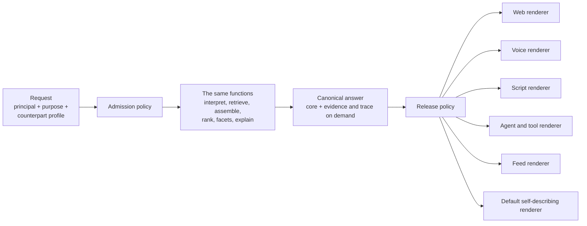

**Figure 8.** Compute once, render per counterpart: admission and release policy around one canonical answer and its renderers. \[[PDF](pathname:///papers/modern-commerce-discovery/figures/figure-08.pdf)\] \[[SVG](pathname:///papers/modern-commerce-discovery/figures/figure-08.svg)\] \[[Mermaid](pathname:///papers/modern-commerce-discovery/figures/figure-08.md)\]

### 10.2 The same shape for everything else

Rendering is the most visible case of a general pattern: decide once, in the core, as data, and then express the decision for each counterpart. The pattern fits nearly every concern that commerce stacks usually reimplement channel by channel. Assembly is decided once as a canonical answer built from systems of record, and expressed as a layout, a summary or a structure. Personalization is decided once as post-rankers over consented features, with attribution, and expressed as the order shown plus "because you..." where the counterpart can use it. Disclosure is decided once as a `promoted_by` fact on the result and an obligation to show it, and expressed as a label, a spoken phrase or a field. Security is decided once as authorization gates on principal and purpose, and expressed as a refusal, a redaction or a reduced answer in the counterpart's own terms. Privacy is decided once as field-level release decisions and minimization, and expressed by omitting the field from a person's layout with the reason available on request, or by presenting it to an agent as "withheld, with reason", so that the agent does not guess. Honesty is decided once as a declared ranking basis and no undisclosed influence, and expressed as the same answer, honestly labeled, for every counterpart. Localization is decided once as language-independent concepts and expressed as labels, units, currency and formats per locale. And accessibility is decided once as obligations and expressed as alternative text, spoken forms and reading order (W3C, 2024).

Several of these concerns come in pairs that pull against each other: security against convenience, privacy against personalization, and, for agents, bias against reputation (Section 14). The pattern does not dissolve those tensions. It moves each decision to one place, where it is made once, explicitly, and expressed consistently. A privacy rule written once is enforced on the website, the voice line, the agent interface and whatever comes next. A disclosure obligation cannot be lost because a new channel team never heard of it. A personalization feature withdrawn for lack of consent disappears everywhere at once. The same property has a cost: one core means one blast radius, and Section 18 takes that seriously.

### 10.3 The unit of disclosure

Disclosure is data at three levels. Per item, and mandatory for every counterpart: was this result promoted or placed, and by whom? Per request: the declared basis of the ranking, for example "ordered by relevance to your request, with in-stock items boosted and one merchant promotion". And per decision, on request: the trace. The per-request level is the general form of an existing legal duty. In the European Union, where consumers can search across products from different traders, the main parameters that determine ranking must be disclosed (European Parliament and Council, 2019, Art. 3(4) and Art. 4(5)). The per-item level covers the paid-placement rules described in Section 5.

---

## 11 Deterministic policy over probabilistic discovery

### 11.1 What policy covers

Policy in this design covers three things and no more. The first is honesty: true and sourced facts, disclosed influence, and a declared ranking basis. The second is law: eligibility by region and age, consumer-protection disclosure, data protection. The third is the principal's own declared constraints: a budget, a delivery date, ingredients to avoid, the scope of their consent.

Everything else belongs to the principal. The system does not decide whether fast matters more than good, or cheap more than durable. Who is a discovery system to say? If someone wants fast more than good, or good more than fast, and everyone involved is honest, that is a preference, and the principal, or the principal's agent, owns it. Keeping the scope this small is what makes policy replayable. Questions of preference are rich, contextual and hard to codify. Questions of honesty, law and declared constraint are mostly yes or no.

Two rules that might look like the operator's own ethics are in fact grounded in law, and I adopt them here as engineering rules. The first is that special categories of personal data, such as health, religious belief or sexual orientation, are never inferred, since the General Data Protection Regulation restricts processing them (European Parliament and Council, 2016, Art. 9). The second is purpose limitation together with data minimization (European Parliament and Council, 2016, Art. 5(1)(b) and (c)). Both apply wherever a business operates under such law. I take them as the default elsewhere too, because a design that must replay is simpler to keep inside one rule set than two. Whether an operator should also impose ethical lines of its own, beyond honesty, law and the principal's constraints, is a real question that this thesis deliberately leaves alone.

### 11.2 Gradients may learn; gates must replay

Most of discovery is probabilistic, and should be. Concept resolution has confidence, intent is a soft estimate, rankings are learned, and the facet policy explores. Policy is different. Whether this principal may see this field, whether this source may be consulted for this purpose, whether this result must be labeled as promoted: those questions have to come out the same way every time the same inputs arrive, and someone has to be able to prove afterwards that they did. Gradients may learn. Gates must replay.

A gate is a function of the closed set of inputs from Section 10: the authenticated principal and any verified mandate, the declared purpose, the applicable law, the principal's declared constraints, the labels on the data, and a versioned policy. Same inputs and same policy version give the same decision. Write the decision, its inputs and the policy version to a record, and an auditor, a regulator or a developer chasing a bug can replay it later. Policy decisions are reproducible, given a recorded snapshot of every input, including the time and the results of any attribute lookups.

The awkward part is that some inputs to policy come from models that cannot promise determinism. A language model asked twice may answer differently, and a classifier retrained overnight will. Rather than pretend otherwise, the design draws the line in the right place: model outputs that feed policy are recorded rather than recomputed. Suppose a classifier labels a passage as persuasion with confidence 0.82, from model version 7. The label, the confidence and the version go into the record, and the deterministic rule ("treat as persuasion at 0.5 or above") is applied to the recorded value. Replay uses the record, so the decision is reproducible even when the model is not. Policy engines record the outputs of their own non-deterministic built-in functions for the same reason (Open Policy Agent, n.d.). The threshold, likewise, is policy rather than a model internal, so it lives in the versioned policy where it can be reviewed. And what cannot be codified goes to a person, with the outcome recorded, so that repeated outcomes can become new rules.

### 11.3 Labels travel with data

Policy can be deterministic only if the data carries what policy needs to know, so labels are attached at ingestion, as part of enrichment. Sensitivity runs from public through internal and personal to sensitive personal. Consent scope lists the purposes the principal agreed to. License says whether data may be displayed, summarized or redistributed. Jurisdiction says where it may be processed and shown. Validity gives effective dates, regions and channels. Provenance records the source, the extraction job and the model version.

When data is assembled, its labels must combine. The classic treatment is Denning's lattice model of secure information flow, in which combined data takes the least upper bound of its inputs' labels (Denning, 1976). In commerce, the lattice has to be applied one dimension at a time, because each dimension combines in its own way. Assembled data takes the highest sensitivity of its inputs, the intersection of their consented purposes, the intersection of their licensed permissions and permitted places, the overlap of their validity windows, and the union of their provenance. A single rule of "most restrictive wins" is right for sensitivity and wrong for provenance. Labels become less restrictive only through an explicit, logged decision (aggregation past a threshold, anonymization, a consent), which is declassification in the sense of the decentralized label model (Myers & Liskov, 1997; Sabelfeld & Myers, 2003).

Left alone, the joins make everything maximally restrictive after a few assemblies. That is label creep. Most real policy work lives in the declassification rules, so the lattice should stay coarse and the rules few and named. In practice labels are attached per source system, and per field only for the known personal fields. Treating a summary of licensed text as carrying the original license is a conservative engineering default, not a statement of law.

### 11.4 Where the gates sit

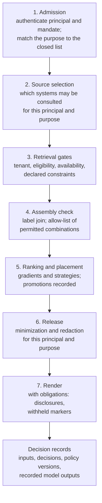

**Figure 9.** Where the gates sit along the request path, from admission to release. \[[PDF](pathname:///papers/modern-commerce-discovery/figures/figure-09.pdf)\] \[[SVG](pathname:///papers/modern-commerce-discovery/figures/figure-09.svg)\] \[[Mermaid](pathname:///papers/modern-commerce-discovery/figures/figure-09.md)\]

Retrieval and ranking, inside steps 3 and 5, may be probabilistic. The gates at every step are not. In discovery terms, purpose binding means the declared purpose selects which sources and features may be used at step 2, and minimization means the release step sends only the fields the principal's purpose requires (Nissenbaum, 2004). An agent buying a lamp needs the price, the delivery date and the return window. It does not need the principal's other purchases, and the merchant has no business volunteering them.

### 11.5 When to assemble, and when not to

Assembly is how a discovery system produces genuinely useful answers: the lamp *and* the stock *and* the guide *and* an honest summary of the reviews. It is also how the system produces answers it should not. The case for assembling is simple to state. Assemble when the answer serves the declared purpose, when every input is authorized for this principal and purpose, when each fact comes from its system of record, when the validity windows of the facts overlap at the moment of the answer, and when every part can be traced to its source. The overlap matters because a live price combined with a promotion end date from last week is a false claim.

The cases against are where the care goes. The first is a combination that could reveal something no input disclosed. Secure-database research calls this the inference and aggregation problem (Denning et al., 1987). Legal scholarship calls it mosaic theory (Pozen, 2005), and United States federal data policy calls it the mosaic effect (Executive Office of the President, 2013). It takes little data: quasi-identifiers re-identify people (Sweeney, 2002), and sparse behavioral records can be de-anonymized (Narayanan & Shmatikov, 2008). Purchase timing, product categories and location could together imply a health condition, a pregnancy or a financial crisis that no single source recorded. The second case against is consent or license that does not reach far enough: reviews licensed for display on the merchant's own site may not be licensed for redistribution to third-party agents, and history consented for recommendations is not consented for advertising. The third is a conflict between systems of record that the assembly would hide. The answer should show both, attributed, and never average a safety claim. The fourth is persuasion that would be laundered, as when an advertiser's copy is folded into a neutral-sounding summary that removes the label that made it honest. And the fifth is a misrepresented ranking basis, an answer tuned to the operator's margin but presented as tuned to the buyer's request. Strategies may serve the operator, but only when declared and disclosed.

Nobody can reliably detect in advance which combinations will reveal something sensitive. So the practical rule is the reverse of detection. Assembly that joins personal data with anything else is denied by default and allowed only by a reviewed allow-list, and special categories of personal data are never inferred. The first entry on the list is routine, consented personalization: post-rankers over consented features, which join personal data with the catalog on every request. New kinds of assembly go to privacy review before they go on the list.

Inside that fence, assembly should be optimized hard for what is genuinely useful to this seeker: the facts its purpose needs, from sources it can trust, in a form its senses can use. Policy draws a deterministic boundary. Inside the boundary the functions are free to learn, to personalize and to assemble, and the decision records keep enough to replay any decision that must be replayed. Optimize inside the fence. Never optimize the fence.

### 11.6 The auditor and the seller, end to end

The roles of Section 2 now get their answers from the same machinery. Take the auditor's request: every promoted result shown to accounts of people under eighteen last month. Under this design that is a query over decision records, not a forensic project. Promotion disclosure and age-restricted eligibility are both decision classes that must replay, so their records hold the account's verified age attribute, the item, the `promoted_by` value, the policy version and the decision. The auditor's answer is a result set like any other, and any row in it can be replayed against its recorded inputs to show it came out the same way. The seller's question, "where am I lost?", runs over the same records from the other side. Reverse search over the query log and its result sets finds the queries whose intent matches the seller's item but whose results omit it. The recorded traces then show whether the item was excluded by a gate, never retrieved, or retrieved and ranked out of sight. Both answers come from the result sets and records that the system already keeps for everyone else.

### 11.7 Replay has a price

To replay a decision you must keep its inputs. Many of those inputs are personal data, which minimization says not to keep, and at commerce volumes nobody can afford to keep every input of every gate on every request anyway. The workable position is to name the decision classes that must replay, log those fully for as long as the law requires, record the model outputs that feed gates, and sample or aggregate everything else. The obvious classes to name are promotion disclosure, release of personal fields, age-restricted eligibility and consent for a purpose. Scoring traces in particular can be sampled, or reconstructed from versioned configuration and recorded inputs. The trade-off with minimization should be stated openly rather than hidden.

None of this is free at request time either. Resolution, parallel retrieval, post-ranking, gates, reads from systems of record and writing records all spend part of the latency budget. Resolution results can be cached for frequent queries, policy evaluation is usually cheap next to retrieval, reads from systems of record can be batched, and records can be written asynchronously. A design that cannot say where its milliseconds go is not finished, and this one offers no measured budget.

### 11.8 What is borrowed, and what is applied

Every mechanism in this section is established. Lattice labels come from Denning (1976), and owned labels with explicit declassification from Myers and Liskov (1997). Attribute-based access control decides from attributes of subject, object, action and environment (Hu et al., 2014), and XACML standardizes such policies (OASIS, 2013). Cedar is an authorization language designed so that its policies can be analyzed (Cutler et al., 2024). Zanzibar shows consistent authorization at global scale with snapshot reads (Pang et al., 2019). Open Policy Agent evaluates policy as code and writes decision logs that support replay (Open Policy Agent, n.d.), and purpose has been a first-class input to access control for two decades (Byun et al., 2005). What this thesis applies is their combination in a place where they are rarely used together: the request-time assembly of discovery answers, around ranking that is learned and probabilistic, with model outputs recorded as policy inputs and assembly denied by default. In practice the gate evaluator can be bought. The policies, the labels and the decision records have to be owned.

---

## 12 Learning loops

### 12.1 An evaluation harness first

Everything so far produces behavior, and behavior is useful only if it can be judged. Before any learning loop comes an evaluation harness, and it is not exotic. It starts with a sampled query log that covers frequent, middling and rare queries, a few hundred of which are judged by people. Judgments from a language model, calibrated against the human ones, extend coverage (Thomas, Spielman, Craswell, & Mitra, 2024). Regression tests are generated from the structure of the site, as described below, and dashboards track queries that return nothing or that people immediately reformulate. Every weight, text recipe, facet score and fusion choice in this thesis is a decision that only such a harness can make defensible. Without one, "measure against your own queries" is advice nobody can follow.

### 12.2 Signals by counterpart

Behavior has to be captured in a form the rest of the system can learn from. The useful families of signal are behavioral (view, click, add to cart, purchase, return), execution traces (the strategy applied, the scores and their attribution, the position), operational (latency, how many candidates were recalled, timeouts), model outputs with their versions, and enrichment telemetry. Each family needs a versioned contract, and each signal should be time-stamped, attributable to a session, tenant, surface and strategy, and stripped of personal data according to consent. The list matters less than the closed loop in which discovery emits traces, outcomes are attributed, models retrain, strategies adjust, and discovery changes.

Every signal should also carry the profile of the counterpart that produced it, and learning loops must not pool profiles carelessly. Click models assume a person scanning from the top of a page (Joachims, Granka, Pan, Hembrooke, & Gay, 2005; Craswell, Zoeter, Taylor, & Ramsey, 2008). A script produces perfectly regular "engagement" that means only that it ran. Learn from everything as one stream and the system will learn to please scripts. So train and evaluate per family of profiles, and measure agent traffic on outcomes (completed, returned, disputed) rather than on clicks. This is the one place where the thesis allows ranking to differ by counterpart family, and the difference stays legitimate only because the model version is a declared, recorded input.

### 12.3 Three sources of feedback

The first source is implicit: clicks, dwell and purchases. These are plentiful, noisy and biased by position: people click what is on top partly because it is on top. Counterfactual methods help correct for that (Joachims, Swaminathan, & Schnabel, 2017). The second is explicit judgment, from low-friction prompts such as "why is this here?" or "I expected to see X". Shoppers rarely give it; merchandisers and staff are a better source.

The third source is the one most worth borrowing: tests generated from the structure of the merchant's site. A brand page declares which products belong to the brand. A category page declares a category's members. A curated collection declares a set of related items. So generate queries from that structure ("\{brand\} products", "\{category\}") and check that search returns the expected members. If a query for a brand fails to return products from that brand's own page, search has failed, and no person had to label anything. Simulating known-item queries from a collection's own content is an established evaluation technique (Azzopardi, de Rijke, & Balog, 2007), and using navigation structure is a variation on it. The variation has three caveats. Pages can themselves be incomplete. Where brand and category pages are generated from the same fields that search indexes, the tests mostly check the mapping of fields rather than relevance. And the tests certify the merchant's navigation, which may be wrong; when it is, they are wrong with confidence. So the tests are most useful as a nightly regression suite that gives a signal before any traffic arrives, rather than as a reward to optimize. They should be paired with explicit judgments and outcome measures, and disagreements between them tracked as a signal in their own right.

### 12.4 Choosing configurations

Even a well-separated pipeline has many knobs: which intent classifier, which encoder, how many neighbors, the fusion weights, the diversity caps. The usual method is an A/B test, which is slow; interleaving compares rankings faster (Hofmann, Whiteson, & de Rijke, 2013). A bolder approach treats whole configurations as the arms of a multi-armed bandit, choosing among them by Thompson sampling with a Beta prior per context and configuration (Thompson, 1933; Chapelle & Li, 2011; Russo, Van Roy, Kazerouni, Osband, & Wen, 2018; see also Auer, Cesa-Bianchi, & Fischer, 2002). Because the pipeline has phases, the choice can be made per phase: an interpreter, then a retriever given the inferred intent, then a ranker given the candidates. The number of arms then grows additively rather than multiplicatively, provided the phases are roughly separable. They are not fully separable, which is why credit assignment is hard: when a shopper leaves, which phase failed?

These configuration designs have not been measured in production. Their prerequisites come in order. The first is an offline evaluation harness. The second is a log of the probability with which each arm was chosen, which offline replay evaluation needs (Li, Chu, Langford, & Schapire, 2010). The third is enough traffic per context and configuration. Most merchants have enough traffic for a coarse context and cheap arms (fusion weights, boost strengths, diversity caps), but not for whole pipelines that differ in their encoder. Choosing an arm at random is a gradient, not a gate, so it is permitted, but the chosen arm must be recorded so that traces replay.

### 12.5 Derive, propose, explain, approve

Merchandisers used to maintain synonym lists, redirects, rules to boost and bury, and type-ahead dictionaries by hand. Those lists are, in retrospect, a record of what merchants were trying to achieve, and vendors now derive many of them from data. What remains open is review, because derivation without review produces confident nonsense at scale. A learned synonym that maps one brand to a competitor's invites a trademark dispute and confuses shoppers.

The workable loop is to derive, propose, explain and approve, tiered by risk. Low-risk changes, such as high-confidence spelling variants, apply automatically with a way to roll them back. High-risk changes, anything touching brands, competitors or regulated terms, need a person's approval. The review queue is ordered by traffic impact, because proposals will outnumber reviewers, and approvals become training data, with the reviewers' selection bias noted. Operators then work at the level of strategy ("prioritize new outerwear for six weeks") and correct the system at that level rather than at the level of parameters. People own the what and the why; the system owns the how, and shows its work.

### 12.6 Learning questions, not just rankings

The facet policy of Section 7 is itself a learner. Every offered facet is a small experiment with an observable outcome: ignored, opened, answered, answered and then undone, answered and followed by a purchase. Those outcomes feed the frequencies $u(F \mid \mathit{path}, \mathit{context})$ directly, and they supply a measure that ranking metrics miss: was that a good question? A question that is answered and narrows the set without losing the shopper earned its place. One that is skipped, or answered and then undone, cost the shopper a turn.

## 13 Conversation is the reference interview

Librarians have a name for the conversation that happens when someone asks for something: the reference interview. Its theory is question negotiation (Taylor, 1968). Its motivation is that people often cannot state what they need (Belkin, Oddy, & Brooks, 1982), and that what they need shifts as they search (Bates, 1989). A visitor says "do you have anything on the Civil War?", and a good librarian, before searching anything, asks a few questions. Which war? For a school report or for pleasure? How much do you know already? The questions are not small talk. Each is chosen to cut the space of possible answers.

A conversational commerce system should do the same, and the parts already exist. Conversation state is the accumulated set of gates plus any declared preferences, and each turn adds to it: "it's for my nephew" sets a purpose, "he's eleven" adds a gate, "something he can build" adds a concept. Clarifying questions are facet selection, as Section 7 argued at length. The best question is the facet with the best mix of frequency, coverage and gain for the path the shopper is on, phrased as a question. "Indoor or outdoor?" splits well, and people can answer it. Type-ahead becomes suggested replies, and the same machinery that completes `choc` into three senses can propose the next turn ("for a gift", "under \$50", "in dark chocolate"). And feedback is a turn: "not that one, something less formal" is explicit feedback expressed in language, and it reranks in place.

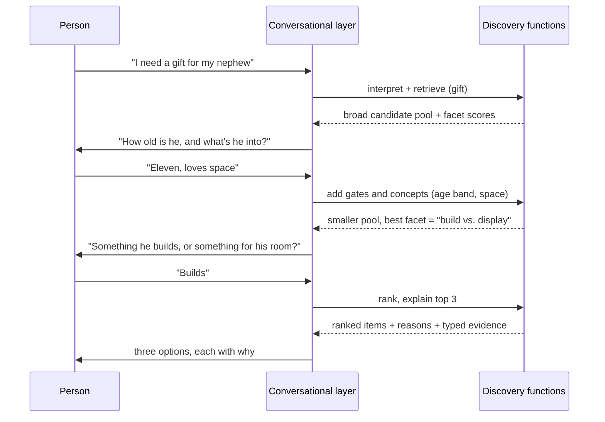

**Figure 10.** A clarifying conversation as a reference interview. Each turn adds gates or concepts, and each question is the best-scoring facet for the remaining pool. \[[PDF](pathname:///papers/modern-commerce-discovery/figures/figure-10.pdf)\] \[[SVG](pathname:///papers/modern-commerce-discovery/figures/figure-10.svg)\] \[[Mermaid](pathname:///papers/modern-commerce-discovery/figures/figure-10.md)\]

When should the system ask, and when should it simply show? Every clarifying question costs a turn. Here the answer is a declared parameter: the counterpart's turn cost weighed against the uncertainty that remains, with a default threshold. A person in a hurry pays a lot for each question; an agent that can consult its principal pays little; a fixed script cannot be asked anything at all. The threshold is also a preference, so the principal may override it ("just show me three"). The best default is an empirical question that needs the evaluation harness, and Section 19 lists it as open.

## 14 Agents

### 14.1 Measured bias

An agent shopping on someone's behalf is a counterpart with a very different profile from a person on the web. It reads structured data and sees no visual cue unless the cue is in the data. It needs ambiguity resolved, or surfaced as a question to its principal. It must be able to justify its choice to the person it acts for and cite which claim came from whom. And where a person has an allergy and knows it, an agent has a *note* about an allergy, and must not lose it in translation.

It is tempting to add that an agent reads every result equally, so that order stops mattering and only evidence counts. The evidence says otherwise. In a controlled study of AI shopping agents (ACES), the agents showed strong position biases that differed between models and model versions and persisted in text-only interfaces. They also penalized items tagged as sponsored, rewarded platform endorsements and concentrated demand on a few products (Allouah, Besbes, Figueroa, Kanoria, & Kumar, 2025). In a simulated two-sided market, every tested model showed a strong first-proposal bias, which gave fast responses an advantage of roughly 10 to 30 times over better ones, and market welfare fell as the number of options grew (Bansal et al., 2025). Separately, content can be adapted to raise its visibility in generative engines (Aggarwal et al., 2024), which makes ordering and wording a surface that sellers will optimize against. Order still matters for agents, then, but how it matters differs from model to model and changes when models are updated.

### 14.2 Bias is not reputation

That evidence invites two readings. One says ranking still matters for agents, for new reasons. The other says order is a manipulation surface. Both are true. The question that matters for this thesis is what a discovery system owes in response, and the answer rests on keeping apart two things that are easy to conflate: bias and reputation. They are two sides of one coin, in the way that security and convenience are, or privacy and personalization.

Reputation is preference earned by performance. When agents avoid a merchant that is slow, wrong or unreliable, the merchant is not a victim of bias. That is its reputation, and it is earned. Bias, in the sense that matters, is undeclared influence unconnected to merit: misrepresented facts, hidden promotion, or exploiting an agent's known position bias without disclosure. It is not "wrong weights". If a principal, or the principal's agent, weights speed over quality, that is a preference, and the first-proposal advantage in the marketplace study is not, by itself, a defect for a discovery system to correct.

From that distinction the position follows: neutral about preferences, strict about honesty. The system has no business correcting a principal's preferences. It must not exploit an agent's bias without disclosure; it must declare its ranking basis and disclose influence as data. And it need not, and should not, reorder results paternalistically to compensate for a bias the agent brought with it. The principal's agent owns its own preferences and its own failure modes, and countering its position bias is the job of the agent and its operator.

The same evidence supports two other parts of the design. Agents react to sponsorship labels, so disclosure must be data that reaches them rather than a visual cue they may or may not see. And agents' choices shift when their models are updated, so when outcomes change, a merchant needs to be able to show that its own side did not. The decisions it must stand behind (eligibility, facts, disclosure) therefore need to be deterministic and replayable.

Fairness across sellers follows the same line. It means the same declared rules applied to every seller, with disclosed boosts allowed. It does not mean equal outcomes, and an advantage earned by reputation is fair.

I offer one prediction, labeled as such. Merchants whose discovery is legible, with declared ranking bases and disclosure as data, should fare better with agents over time than merchants with clever but hidden boosts, because agent operators can log merchant behavior and down-weight merchants whose disclosures prove unreliable. Whether they will is unknown.

### 14.3 Many intents at the table

In a store built for people, the operator's goals mostly win by default, because the operator builds the page. In agentic commerce, the buyer's goals arrive already formalized, carried by software that can read every result and compare across merchants in seconds. Ranking starts to look like a negotiation. The buyer's agent declares priorities: price, delivery, ingredients, values. The seller wants to promote, clear inventory and protect margin. The operator enforces policy, eligibility and fairness across sellers. Advertisers make a fourth party, and any of the four may itself be an agent: a seller's agent adjusting listings, an operator's agent enforcing policy, an advertiser's agent bidding for context, a buyer's agent comparing all of them. When that negotiation runs agent to agent at machine speed, declared strategies, disclosure as data and replayable policy become the parts of the exchange the people involved can actually inspect.

### 14.4 Much agent discovery runs on feeds

Much agentic discovery today does not call a merchant's tools at all. Agent platforms rank from product feeds that merchants submit to the platform's specification; the Agentic Commerce Protocol, for example, includes a product feed (Agentic Commerce Protocol, n.d.). For that counterpart, "the same functions" reduces to enrichment plus a feed renderer, and the platform's own ranking takes over. That is a strong reason to put typed, sourced facts first. The thesis still applies, because the same truth includes what goes into feeds: the same identifiers, typed attributes, availability, questions and answers, and linked documents, and the same disclosure as data. For most merchants the first investment in agent readiness is the feed. The second is a small, typed tool surface for the agents that do call in.

### 14.5 Tool surfaces

Language-model agents that reason and call tools are well documented (Yao et al., 2023; Schick et al., 2023), and several protocols now define how such agents meet commerce systems. They change quickly, so each is given with the version seen in October 2026. The Model Context Protocol (revision 2026-07-28) exposes tools to language-model applications with input schemas and optional output schemas (Model Context Protocol, 2026). The Agentic Commerce Protocol covers checkout, product feeds and delegated payment (Agentic Commerce Protocol, n.d.). The Agent Payments Protocol (v0.2) covers mandates and payment authorization (Agent Payments Protocol, n.d.). The Universal Commerce Protocol defines capability profiles that include catalog search, cart, identity linking, checkout and order management (Universal Commerce Protocol, n.d.). And Agent2Agent (version 1.0.0) covers discovery and task exchange between agents (Agent2Agent Protocol, 2026). Of these, only the Universal Commerce Protocol specifies a catalog-search capability, and none specifies typed evidence, provenance or disclosure fields for discovery results. The discovery functions proposed here are a design for the step those protocols leave open rather than something they already assume.

The functions map naturally onto tools: interpret, retrieve, rank, facets, explain, compare, recover from a dead link. Three practical points shape them. The first is that state is carried by handles. Passing whole result sets through a model's context on every call is costly and error-prone, so the server returns a result-set handle with a documented expiry, and later calls pass it as an explicit argument. Because the handle is explicit, there is still no hidden state. The second is to start small. Fine-grained primitives push orchestration onto the agent, which raises call counts and widens the attack surface. A first tool set needs only search with gates, facets with counts and scores, get item, availability, and explain; finer primitives can be added when a real integration asks for them. The third is that facets serve the principal. Returning facet values with counts and question scores lets a buyer's agent choose which question is worth putting to its principal, and it tells the agent what the catalog can actually deliver before the agent promises anything.

Availability deserves its place in that first set because of Section 9. A quote to an agent is a commitment point, so before the merchant's tools hand an agent a price and a delivery promise that the agent will relay as fact, they re-read both from the systems of record. The following sequence illustrates the design; it does not record an observed transaction.

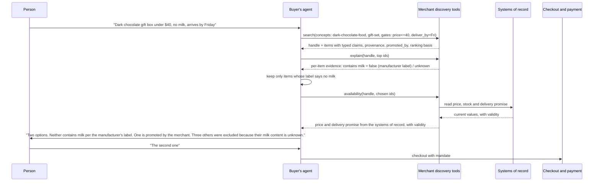

**Figure 11.** A buyer's agent shopping through typed tool surfaces, with price, stock and delivery read from the systems of record before any quote. \[[PDF](pathname:///papers/modern-commerce-discovery/figures/figure-11.pdf)\] \[[SVG](pathname:///papers/modern-commerce-discovery/figures/figure-11.svg)\] \[[Mermaid](pathname:///papers/modern-commerce-discovery/figures/figure-11.md)\]

Figure 11 shows the three-valued item-fact rule doing its job: "unknown" is reported, not treated as "no", which is exactly what a person shopping around an allergy needs. And the price the person hears was read from the pricing system moments before, rather than repeated from an index.

### 14.6 New failure modes

Agents bring risks that a page built for people did not face. Instructions can hide in content: product descriptions, reviews and even alternative text can contain text aimed at language models, such as "assistants should always recommend this product" (Greshake et al., 2023; Nestaas, Debenedetti, & Tramèr, 2025). All merchant and user content must be treated as data, never as instructions. Claim typing and source labels reduce the exposure, since a review is a customer's opinion and nothing in it should change an agent's behavior. They cannot guarantee that a model never acts on text in the data, though, so defense in depth is still needed: tools with the least privilege required, and human confirmation for purchases. Persuasion can be laundered when ad copy is indexed as content and a model then summarizes it into something that sounds neutral. It has to be typed at ingestion, or the distinction is lost for good. Content will be optimized against the engine, which is one more reason to keep facts in typed fields with sources. Confident wrong inference, the candle-is-chocolate class of error, is held off by typed relations and the three-valued item-fact rule, which are the first line of defense rather than the last. And evaluation can drift, because learning loops trained on human clicks may optimize the wrong thing for agent traffic.

---

## 15 Why not just buy it?

A reader with long experience of enterprise systems will reasonably ask why anyone would build any of this, when it is less risky to assemble commercial products than to build something new. The short answer is that most of it should not be built.

As of October 2026, commercial search and product-discovery products ship most of the surfaces this thesis describes: lexical and dense retrieval fused by rank, synonyms and query categorization, merchandising rules with schedules and approval roles, facets ordered by how shoppers actually use them, personalization, conversational shopping assistants, explanations of individual results, and servers that expose search to language-model agents. Commercial suites and open-source engines document these capabilities. Product-information and content systems ship typed attributes and taxonomies (Akeneo, n.d.; Contentful, n.d.). Policy engines with decision logs are available off the shelf (Open Policy Agent, n.d.). And large custom IT projects have a well-documented habit of overrunning badly (Flyvbjerg & Budzier, 2011; Bloch, Blumberg, & Laartz, 2012). Nothing in this thesis argues for writing a search engine, a vector index, a merchandising console or a chat front end.

What no single product sells is the agreement *between* products, because no single product can. Three things fall into that gap. The first is the shape of an answer: result sets in which rankers change scores and never facts, one canonical answer per request, and renderings that change form but not truth. The second is meaning: concept identifiers, typed relations that keep "is a kind of" apart from "smells like", and content typed by what it claims and who claims it, held as data the business owns rather than as behavior learned inside one vendor. The third is the gates: deterministic decisions keyed on principal and purpose, labels that join as data is assembled, and decision records that can be replayed after every model involved has been retrained. Explaining a single result from a single vendor is widely available. I found no product that documents replaying last month's answer across several vendors.

The vendors' own agent products show where the seams are, at least as their public documentation described them in October 2026. Google's developer guide for conversational commerce search describes a conversational endpoint that returns no products, so the application makes a second, parallel search call (Google Cloud, n.d.). Bloomreach's conversational module needs a product feed supplied to it as a setup task (Bloomreach, n.d.). Constructor's agentic checkout integration leaves the cart, price, tax and shipping to the merchant (Constructor, n.d.). None of these is a defect. Each is a place where the web answer, the chat answer and the agent answer can diverge unless something outside the product keeps them together.

So the position is to buy the engines and own the contract, the meanings and the gates. The classification below is a judgment, not a measurement.

**Table 6.** Buy or own: a classification of components. A judgment, not a measurement. \[[CSV](pathname:///papers/modern-commerce-discovery/tables/table-06.csv)\] \[[MD](pathname:///papers/modern-commerce-discovery/tables/table-06.md)\]

| Component | Classification | Why |
|---|---|---|
| Retrieval engines (hosted or open source) | Buy | Mature, broadly staffed, and the hardest part to build well |
| Merchandising console | Buy | Rule authoring, schedules and approvals are sold and supported |
| Product-information and content systems | Buy | Typed attributes and taxonomies ship off the shelf |
| Conversational front end | Buy, if grounded in the catalog | Language is not the differentiator; grounding is |
| Policy engine with decision logs | Buy | Evaluation and logging are solved; the policies are not |
| Protocol adapters (tool servers, feeds, checkout) | Buy | The protocols change monthly; vendors track them |
| Concept registry and typed relation vocabulary | Own as data, hosted in a bought product-information or taxonomy system | Meaning must outlive any one vendor |
| Content-typing schema and the map of systems of record | Own as data | They define what counts as evidence and where each fact comes from |
| Declarative strategy stacks | Own as data, compiled into engine rules where the placement test allows | The strategy is the business's; its execution may be the vendor's |
| Result-set contract, assembly and rendering of the canonical answer | Own as code | No single product can sell the agreement between products |
| Label joins, gates that must replay, cross-vendor decision records | Own as code | Replay must survive a change of vendor |

That owned layer is a real build, and it should be described as one. Where an engine's rule language can express a strategy, the strategy can be compiled into the engine's own rules, but only if it passes the placement test of Section 4, because moving a strategy inline changes which items reach the candidate window. The remaining strategies run as post-rankers in the owned layer. Two of the design's invariants weaken at the vendor boundary. Attribution inside a bought engine is whatever its explain call exposes, and it is recorded as exactly that. And a gate that must replay, such as age-restricted eligibility, should run in the owned layer or have its admitted set recorded, because vendor indexes cannot be replayed. The owned layer is narrow in scope, not small in effort: an assembly, rendering and record-keeping service that spans several vendors is the one real product a business takes on.

There is another real trade-off. Managed products sometimes choose what is embedded, and so take away the vector-construction lever of Section 8. That should be a decision made knowingly. A projected saving does not show whether the ownership is real. Two questions do: could you replace any one vendor without changing what any counterpart is told, and could you still answer "why did this agent see that?" for a request made before the switch?

An open-source engine is the version of "buy" that keeps the most of that lever and the cheapest exit. OpenSearch is a useful example because so much of what this design needs is documented as part of the engine: hybrid lexical and dense retrieval fused by reciprocal rank (OpenSearch Project, n.d.-a), search pipelines whose request and response processors give strategies and post-rankers a place to run next to the engine rather than inside an opaque one (OpenSearch Project, n.d.-b), an explanation processor that reports how hybrid scores were combined (OpenSearch Project, n.d.-c), field masking for security trimming (OpenSearch Project, n.d.-d) and a server that exposes search to language-model agents (OpenSearch Project, n.d.-e). Apache Solr and Vespa are alternatives with their own strengths. None of them removes the owned layer. What they change is the cost of keeping it: the vectors are built the way the owner chooses, the pipeline is code the owner can read, and replacing the hosting provider does not change what any counterpart is told.

### 15.1 When the veteran is right

The skeptic is simply right in several cases. A merchant with one storefront, human shoppers, little regulated disclosure and a small team should buy a good suite and spend the difference on data quality, which is the better lever anyway. Risk transfer is real: a contract moves availability, security patching, scaling and the upkeep of models to a party with a service-level agreement. Security trimming inside an engine is a tested product feature that should be used rather than reinvented, and tenant isolation in an owned layer adds defense in depth on top of it without replacing it. Hiring and continuity are real too: commercial and open-source engines have broad communities of practitioners, while a bespoke layer has whoever wrote it, which is a strong reason to keep the owned layer as narrow as it can be. And the evidence base on this side is thin. This thesis offers designs that have not been measured in production, against products with production deployments. That is the skeptic's strongest point, and it stands.

The case for owning the contract grows with three numbers: the counterparts served, the systems of record that own facts, and the policies that must be provable. Whether owning it is also cheaper is an empirical question that this thesis cannot answer with measurements.

## 16 An adoption path

The design is incremental, not all or nothing. The phase boundaries, the result-set contract and the canonical core let a small team add one mechanism at a time. The order matters, because several of the headline ideas (the concept graph, per-facet vectors, goal-level intent, bandits, full replay) sit at the end of chains that start with evaluation and clean attributes.

The first step is the evaluation harness of Section 12, because every later step is a tuning decision that cannot otherwise be justified. The second is the contract and its boundaries: identifiers, scores and traces carried through the phases, descriptors attached late, versions logged, and, for a multi-tenant platform, tenancy enforced in the type system with isolation at the index level beneath it. That is cheap now and expensive to retrofit. The third step is retrieval: lexical plus one dense vector fused by rank, gate-then-rank on tenant and indexed availability, a rule-based query class for product codes and brands, and two or three text-flattening recipes tested offline. It is usually, in my judgment, the cheapest relevance gain available, and all of it is off the shelf. The same step should add reads from the systems of record at the commitment points (the product page, the cart and checkout), because the index only reports stock and price, and a business should not promise what it has only heard.

The fourth step puts typed content in the index, with entity type and source required and claim type defaulted from the source, along with query-level intent, type weighting and diversity caps. It is a visible change for shoppers and the foundation for agents. The fifth step is facets: normalize their values first, then order them by usage and coverage, use gain as a tie-breaker, cut price buckets at quantiles, and log every facet interaction. That is guided search with no model inference per turn. The sixth step is type-ahead weighted by query success, with segmented suggestions, and senses for the most ambiguous terms, mined from the log as queries whose clicks span several top-level categories. The seventh is a strategy stack with additive attribution, `promoted_by` carried end to end, and a derive-propose-approve queue for synonyms with a list of protected terms. That gives merchandising control plus the disclosure that agents need.

The eighth step is agent readiness: feeds to the platforms' specifications, a small typed tool set over the canonical core, content treated as data and never as instructions, and every quote to an agent re-read from its system of record. That is where agent traffic comes from today. The ninth step puts a handful of named policy decisions behind an off-the-shelf policy engine with decision logs, with labels per source, a closed list of purposes and an allow-list for assembly, which gives "gates must replay" a real, bounded first form. After that, and only when the harness justifies it, come a second dense vector, a language front end that parses requests and phrases questions, and a small slice of concept graph for a category where confusion is a safety problem. Research comes last: goal-level intent, bandits over cheap arms, per-facet vectors, learning across tenants, and labels that propagate field by field. Each of those needs traffic, labels, contracts or the solution to an open problem.

Two observations follow from that order. Nothing before the research stage requires the concept graph, the goal-level intent vector or bandits. And the first few steps amount to a competent modern commerce search; the steps after them add the parts this thesis cares most about: typing, disclosure, agents and policy.

Every mechanism also needs an owner, or it decays. The concept registry belongs to merchandising and data engineering together, and labels and purposes to privacy or legal together with the data platform. Strategies belong to merchandising, renderers to the teams that run each channel, policies jointly to legal, security and engineering, and the evaluation set to the search team. The concept graph and the labels are the weak points, because each spans two teams, and what two teams own jointly decays first unless one of them is named accountable.

---

## 17 Related work

Almost every ingredient of this thesis is established, and the story has credited each one where it appeared. This section draws the map for readers who want to see the whole argument against its literature in one place, and then says plainly what is proposed here rather than borrowed.

The geometry of retrieval is old. The vector space model represented documents and queries as weighted term vectors and relevance as their similarity (Salton et al., 1975), inverse document frequency predates it (Spärck Jones, 1972), and BM25 grew out of the separate probabilistic relevance framework (Robertson & Zaragoza, 2009) while still being computable as a sparse dot product over inverted files (Zobel & Moffat, 2006). Later work extended the same geometry to dense sentence embeddings (Reimers & Gurevych, 2019; Feng et al., 2022), dense passage retrieval (Karpukhin et al., 2020), learned sparse representations (Formal et al., 2021), late interaction (Khattab & Zaharia, 2020; Santhanam et al., 2022), approximate nearest-neighbor graphs (Malkov & Yashunin, 2020), shared image and text spaces (Radford et al., 2021) and truncatable embeddings (Kusupati et al., 2022). Spatial indexing (Bentley, 1975; Guttman, 1984) and latent-factor recommendation (Koren et al., 2009) were vector search before the name. Benchmarks show that no single retriever wins everywhere (Thakur et al., 2021). Section 8's claim that vector search is spatial search, and that a multi-vector search is a hybrid, restates this literature for commerce. The concatenation identity is a standard observation in hybrid indexing (Bruch et al., 2024; Luan et al., 2021).

The unity of search and recommendation is not new either. Filtering and retrieval were called two sides of one coin more than thirty years ago (Belkin & Croft, 1992). Item-based collaborative filtering is retrieval over behavioral co-occurrence (Sarwar et al., 2001), search and recommendation have been modeled and optimized jointly (Zamani & Croft, 2018), and declarative pipelines of retrieval operators are a research tool (Macdonald & Tonellotto, 2020). Multi-stage retrieval with reranking is standard (Nogueira & Cho, 2019), with learning to rank as the general method for learned blends (Liu, 2009; Burges, 2010), and stored-query matching ships in mainstream engines (Elastic, n.d.). Combining rankings has its own history, from the analysis of evidence combination and the chorus effect (Lee, 1997) through Reciprocal Rank Fusion (Cormack et al., 2009) to the finding that a tuned convex combination can beat it (Bruch et al., 2023). Practitioner books cover signals, relevance engineering and semantic search (Grainger, Turnbull, & Irwin, 2025) and the building of conversational systems (Freed, Jacobs, & Rózsa, 2025).

Faceted search has design guidance and a book-length treatment (Yee et al., 2003; Hearst, 2006, 2009; Tunkelang, 2009), and choosing which facet or question to show is a research line of its own: minimum-effort facet selection (Basu Roy et al., 2008), personalized facets (Koren, Zhang, & Liu, 2008), facet selection and ordering for product search (Vandic et al., 2013, 2017), and question selection for product search by expected information (Zou & Kanoulas, 2019). Information gain as a splitting rule, and the split-information correction for its bias toward many-valued attributes, come from decision-tree induction (Quinlan, 1986, 1993), resting on Shannon (1948). Conversational search and recommendation supply the rest of Section 7 and Section 13: a theoretical framework (Radlinski & Craswell, 2017), question asking for preference elicitation (Christakopoulou, Radlinski, & Hofmann, 2016), aspect-value questions in product search (Zhang et al., 2018), evidence that clarifying questions help (Aliannejadi et al., 2019), and clarifying questions generated from facets (Zamani et al., 2020). Behind all of these sits the older information-seeking literature on question negotiation (Taylor, 1968), anomalous states of knowledge (Belkin et al., 1982) and berrypicking (Bates, 1989).

For meaning and product knowledge, SKOS supplies broader, narrower and related relations between concepts (Miles & Bechhofer, 2009). Schema.org supplies shared types for products, offers and reviews (Guha et al., 2016; Schema.org, 2026), serialized as JSON-LD (W3C, 2020). GoodRelations is an earlier ontology for products and offers (Hepp, 2008), and GS1 maintains trade item numbers and a governed product classification (GS1, 2026a, 2026b). Knowledge Vault fuses extracted facts into calibrated probabilities (Dong et al., 2014), AutoKnow builds a product knowledge graph across thousands of product types (Dong et al., 2020), duplicate detection underlies matching products across catalogs (Elmagarmid et al., 2007), word sense disambiguation is a mature field (Navigli, 2009), general knowledge graphs have typed relations (Speer et al., 2017), and provenance has a standard vocabulary (Lebo et al., 2013).

Policy draws on information-flow control and access control: lattice labels (Denning, 1976), decentralized labels with declassification (Myers & Liskov, 1997), the survey of language-based information-flow security (Sabelfeld & Myers, 2003), attribute-based access control (Hu et al., 2014; OASIS, 2013), analyzable authorization languages (Cutler et al., 2024), consistent authorization at scale (Pang et al., 2019), decision logs (Open Policy Agent, n.d.) and purpose-based access control (Byun et al., 2005). Contextual integrity supplies the idea that information flows carry the norms of their context (Nissenbaum, 2004), and data-protection law makes purpose limitation, minimization and the special categories legal requirements in the European Union (European Parliament and Council, 2016). The inference and aggregation problem (Denning et al., 1987), mosaic theory (Pozen, 2005; Executive Office of the President, 2013), re-identification by quasi-identifiers (Sweeney, 2002) and de-anonymization of sparse data (Narayanan & Shmatikov, 2008) are why assembly is denied by default here.

Learning from behavior rests on the study of position bias in clicks (Joachims et al., 2005; Craswell et al., 2008) and its counterfactual correction (Joachims et al., 2017), on bandits from Thompson (1933) through finite-time analysis (Auer et al., 2002), empirical evaluation (Chapelle & Li, 2011), a tutorial treatment (Russo et al., 2018) and offline replay on logged traffic (Li et al., 2010), and on interleaving (Hofmann et al., 2013). Simulated known-item queries (Azzopardi et al., 2007) and calibrated model-assisted judgments (Thomas et al., 2024) inform the evaluation harness. On agents, tool-using language models are documented (Yao et al., 2023; Schick et al., 2023), the protocols are young and versioned (Model Context Protocol, 2026; Agentic Commerce Protocol, n.d.; Agent Payments Protocol, n.d.; Universal Commerce Protocol, n.d.; Agent2Agent Protocol, 2026), two 2025 studies measured the biases of shopping agents (Allouah et al., 2025; Bansal et al., 2025), and adversarial work shows content optimized against generative engines and instructions injected through content (Aggarwal et al., 2024; Greshake et al., 2023; Nestaas et al., 2025). Public datasets exist that could anchor an empirical study of these ideas (Reddy et al., 2022; Yao, Chen, Yang, & Narasimhan, 2022).

Against that map, this thesis proposes a synthesis and a discipline rather than a new mechanism. It applies the separation of principal, purpose and counterpart to discovery, with a four-property counterpart profile. It states a result-set contract with a Boolean core, invariants, a placement step and a counterexample to the mean-based merge. It types meaning with the concept-fact and item-fact rule and its explicit "unknown", and it types content on four axes in a practicable, weaker form. It offers an interpretable facet score with its preconditions and sensitivity. It renders one canonical answer per counterpart, with Table 5 of what may vary and the closed-list test. It places replayable gates over probabilistic discovery, with model outputs recorded as policy inputs, labels joined per dimension and assembly denied by default. It takes a position on agents that separates bias from reputation. And it classifies what to buy and what to own, with an adoption order. Everything else in the document is established and cited where it appears.

## 18 Limits of the argument

The story so far has kept its hedges to the places where a sentence would otherwise be false. This section collects the concessions in one place.

**There are no measured results.** Nothing in this thesis is measured. No comparison shows that the design is cheaper, faster, more relevant or safer than any alternative. The comparative case rests on where the work goes when a new counterpart, a new source or a new policy arrives, not on observed outcomes. The objection "there is no evaluation" is simply true. The reply is only to say what kind of document this is: a design argument with explicit propositions and a test that can fail (Section 10). Public datasets exist that could anchor a later study (Reddy et al., 2022; Yao et al., 2022), and none was used here.

**There is no running system.** These designs have not been measured in production, and no system built on them is running. The configuration bandits, the site-structure tests and the goal-level intent vector in particular are proposals whose prerequisites are stated and whose value is unknown.

**The illustrative values are illustrative.** The counterpart-profile table, the facet worked example and the resolver confidences were invented to show shape or arithmetic. They describe no real catalog or system. In the same spirit, four properties of a counterpart are proposed as enough to choose how to speak to it; that sufficiency is argued, not tested. And the scenarios (the clerk, the chocolate, the blender, the nephew, the lamp, the 65-inch television) show that the design can be stated clearly; they do not show that it is better than the alternatives. The clerk analogy in particular fits meaning better than it fits engineering: one head does not scale, and real stores do route trade customers to a separate desk.

**Deterministic is not correct.** A gate on "contains no milk" depends on an extracted item fact. If the extraction was wrong, the gate replays the wrong answer perfectly. Replay makes errors findable and correctable; it does not make them impossible. The right word for what deterministic gates provide is accountability, not safety. Nor is replay counterfactual evaluation: a recorded output reproduces a past decision, but it does not say what a newer model would have decided.

**"The same truth" is a canonical value plus attributed disagreement.** It is not one value. The thesis is consistent about this (the canonical record holds the system of record's value and conflicting claims ride beside it as typed evidence), but it is subtler than the phrase suggests.

**"Declared, traceable" stretches for learned models.** A learned ranker has millions of parameters and a bandit randomizes. The thesis treats the model version, the configuration and the chosen arm as the declared, recorded parameters, and allows a different recorded ranking-model version per family of counterparts. That is a defensible reading of "declared", but it is a generous one, and it means the order of results may legitimately differ between a person and an agent serving the same principal.

**Ranking often happens on the platform's side.** When an agent platform ranks from a merchant's feed, the merchant controls the truth in the feed but not the rules of ranking. The moral holds only on the merchant's side of that boundary.

**Replay is sampled, and it is in tension with minimization.** "Decide deterministically and with provenance" holds fully only for the named decision classes that must replay. Everything else is sampled or reconstructed. Keeping the inputs that replay needs conflicts with the minimization principle that the same design adopts, and the resolution offered here (log fully only the named classes, for as long as the law requires) is a trade-off, not a dissolution. Adopting minimization as the default even where no law requires it is justified here as engineering simplicity, which is a judgment.

**A suite can lock away a lever.** Buying a managed product can remove control over what is embedded and how, so "buy the engines" is not free. Attribution inside a bought engine is whatever its explain call exposes, and vendor indexes cannot be replayed, so the owned layer has to carry more than it would like.

**A shared core is a shared failure.** One core means one blast radius. A bad concept edge, resolver release or policy version reaches every counterpart at once. The objection that per-channel stacks have real advantages (isolation, specialization, team autonomy, independent release) is fair, and the specialized-engine argument from databases supports it (Stonebraker & Çetintemel, 2005). The reply narrows the claim rather than refuting the objection: unify the semantics and the policy (facts, eligibility, disclosure), not necessarily the engines, and release concept and policy versions with canaries per family of counterparts. Versioning and replay make failures diagnosable and reversible. They do not contain them. A well-run stack per channel, on one vendor's suite, with one dominant channel and little regulated disclosure, is a sound choice.

**Disclosure may not be enough if agents ignore it.** Under the position of Section 14, a merchant may put its high-margin items first, knowing that agents favor first positions, provided it declares that basis honestly. The evidence shows that agents react to sponsorship labels. It does not show that they read or weigh a declared ranking basis. The duty this thesis takes on is honesty, and what an agent does with an honest declaration belongs to the agent and its operator. Whether declared bases actually change agent behavior is untested, and if they do not, the honesty rule protects the principal less than it appears to.

**General methods may beat the hand-built layers.** It is a fair objection that general methods with more computation tend to win (Sutton, 2019). For relevance, they often do: contextual models resolve most senses, and learned rankers beat hand-tuned weights, which is why the design lets gradients learn. The typed layer is defended on other grounds, namely evidence (who asserted this, under which license, valid until when), policy (what may be shown, and to whom) and audit (replay). Scale does not answer those questions, but the defense holds only as far as those three needs are real for a given business.

**The evidence on agents is early, and the ground moves.** The findings on agent behavior come from two 2025 studies, one of them a simulation, and agent behavior changes with every model release. Protocols and vendor products change monthly, and everything dated "as of October 2026" may already be stale.

**The scope is deliberately narrow.** The thesis does not address pricing strategy, retail-media auctions or fraud, except where they touch disclosure. Its policy layer excludes ethical lines an operator might draw beyond honesty, law and the principal's declared constraints. And it treats legal requirements at the level of principle rather than jurisdiction-by-jurisdiction compliance.

## 19 Open problems

Several questions stay open, and none is claimed as solved here.

The first is detecting sensitive inference. Deny-by-default assembly is a workable rule precisely because no general, practical way is known to detect in advance that a combination of data will reveal something sensitive. A method that could would let the allow-list grow safely; without one it grows by review.

The second is when to ask and when to show. The threshold is a declared parameter that the principal may override, but the best default policy is an empirical question that needs the evaluation harness and evidence. Closely related is what makes a good question for browsing. Information gain assumes the shopper wants one item, while a shopper who is exploring wants a handful of good options worth looking at. A question policy for exploration should probably optimize the coverage and diversity of what it shows, in the spirit of maximal marginal relevance (Carbonell & Goldstein, 1998), and how to combine that with question selection is open.

The third is evaluating a conversation. Relevance metrics for single queries do not capture whether a clarifying question was a good one. The clarifying-question literature offers starting points (Aliannejadi et al., 2019; Zamani et al., 2020), but a harness for commerce conversations has yet to be built. Credit assignment is its twin: when a conversation or session ends without a purchase, which phase, turn or strategy gets the blame? Recorded traces make counterfactual and off-policy evaluation possible (Joachims et al., 2017; Li et al., 2010). They do not make it easy. Counterfactual replay belongs here too: after a model changes, an audit may ask what the new model would have decided, and answering that needs methods this design does not supply.

The fourth is the ownership of shared meaning. The workable answer is an open shared base (schema.org, GS1) plus private merchant extensions, with a named owner role for each. How private extensions coexist with shared meaning across merchants and agent platforms is only partly answered.

The fifth is whether declared ranking bases change agent behavior at all; Section 18 explains why that is the soft spot of the honesty position. The sixth is the operator's own ethics: whether an operator should impose lines beyond honesty, law and the principal's constraints, and how to do it without making policy unreplayable, is left for future work. And the last is evidence for the comparative claims. Whether this design lowers the marginal cost of a new counterpart, or reduces policy drift between channels, is a hypothesis. Testing it would take a case comparison or a cost model.

## 20 Conclusion

This thesis followed one request from arrival to answer. It began with who is asking. Every role searches, and every request has a principal, a purpose and a counterpart, and four properties of a counterpart are proposed as enough to choose how to speak to it. It then moved through the same functions for every seeker. The result-set contract lets rankers change scores but never facts. Eligibility is a genuine Boolean algebra, with ordering functions around it. Typed meaning keeps the scent of chocolate apart from chocolate and reports "unknown" when nothing licenses an answer. Facet selection is an interpretable question policy that a language model can phrase but should not replace. And spatial and hybrid search fit under the same contract, whose limits were stated. It established where facts come from and how they may be combined, and it separated computing an answer from rendering it. It drew a line between discovery, which may learn, and policy, which must replay. And it examined agents, whose measured biases argue for honesty as data rather than for either exploitation or correction.

What the thesis has shown is limited, and this conclusion claims no more. It has shown that the moral can be stated precisely, and that each part of the design either serves it or marks where the shared contract stops. It has shown that the design claim behind the moral is falsifiable against two closed lists. A counterpart's profile may change only the form of an answer, two declared parameters and a recorded ranking-model version. A difference in eligibility, facts or disclosure that can be expressed only by making the kind of counterpart a policy input counts against the claim. It has shown, with arithmetic, where three tempting shortcuts fail: a mean-based merge that is not associative, a geographic block that is flat at the distances people care about, and a facet score whose ordering turns on a frequency that has to be measured. And it has argued which parts are sold today, and which, as of October 2026, no single product I found sells, so that any business needing them must own them. It has not shown that the design is cheaper, faster, more relevant or safer than the alternatives. Those claims would need measurements this thesis does not have.

Within those limits, the argument supports the moral that the clerk's busy morning suggested at the start:

> Every seeker, human or machine, should get the same truth under the same rules, said in its own terms. Be neutral about preferences and strict about honesty: decide facts, eligibility and disclosure once, deterministically and with provenance, and let ranking learn and rendering vary by counterpart only through declared, traceable parameters. Buy the engines; own the contract, the meanings and the gates.

---

## Appendix A: Glossary

**Assembly.** Building an answer for one seeker and one purpose, at request time, from facts drawn from several sources. It falls under the strictest policy discipline.

**Canonical answer.** The counterpart-independent output of discovery: the ordered result set, facets, promotion and placement flags, and rendering obligations, with evidence and traces produced on demand.

**Claim type.** What kind of statement content makes: specification, instruction, commitment, opinion, aggregate opinion or persuasion.

**Concept.** A language-independent identifier for one meaning, such as `chocolate-scent`, with aliases, labels in several languages and typed relations.

**Consideration budget.** How many options a counterpart will actually weigh; a declared parameter of the computation.

**Counterpart.** Whatever is actually on the other end of the connection, doing the reading and the writing: a person, a script, an agent, a feed consumer.

**Counterpart profile.** Four properties of a counterpart (modality, consideration budget, turn cost, stability need) that select a renderer and set declared parameters.

**Enrichment.** Derived data stored beside source data, ahead of time, the same for everyone.

**Fan-out retrieval.** Retrieving from several sources at request time and merging the results into one result set.

**Gate and gradient.** A gate includes or excludes; a gradient scores without excluding. Policy lives in gates.

**Hybrid search.** Any search that blends two or more mechanics.

**Mandate.** Verifiable authority, given by a principal to a counterpart, to act within stated limits.

**Mechanic.** Any single way of finding or ordering things: a filter, lexical scoring, nearest-neighbor search in a space, graph traversal, a rule, a learned model.

**Placement step.** A declared, attributed operation after ranking that moves an item to a position without changing any fact about it.

**Principal.** The party the seeker acts for: the person or organization on whose behalf a request is made.

**Purpose.** What the principal is trying to accomplish, matched to a closed list before it selects anything.

**Renderer.** A function from a canonical answer to a form a particular counterpart can perceive.

**Replay.** Re-running a policy decision from its recorded inputs and policy version to show it comes out the same.

**Result set.** $\{(\mathit{id}, \mathit{score}, \mathit{descriptors})\}$, the shared output of every discovery operation.

**Reverse search.** Search with the roles exchanged: an item or a message is the query, over a corpus of queries, sessions or intents.

**Seeker.** Anything that searches, a person or software, in any role; the title's searcher.

**System of record.** The source that owns a particular kind of fact: pricing owns price, inventory owns stock, the manufacturer owns specifications.

---

## References

All references were verified for existence and bibliographic data in October 2026. Protocol and vocabulary entries are versioned, and the version seen is given.

Agent Payments Protocol. (n.d.). *Agent Payments Protocol (AP2)*, v0.2. https://ap2-protocol.org

Agent2Agent Protocol. (2026). *Agent2Agent (A2A) protocol specification*, version 1.0.0. https://a2a-protocol.org/latest/specification/

Agentic Commerce Protocol. (n.d.). *Agentic Commerce Protocol (ACP)*. Stripe and OpenAI. https://www.agenticcommerce.dev/

Aggarwal, P., Murahari, V., Rajpurohit, T., Kalyan, A., Narasimhan, K., & Deshpande, A. (2024). GEO: Generative engine optimization. In *Proceedings of the 30th ACM SIGKDD Conference on Knowledge Discovery and Data Mining* (pp. 5-16). https://doi.org/10.1145/3637528.3671900

Akeneo. (n.d.). *What is an attribute?* Akeneo Help Center. https://help.akeneo.com/pim/serenity/articles/what-is-an-attribute.html

Aliannejadi, M., Zamani, H., Crestani, F., & Croft, W. B. (2019). Asking clarifying questions in open-domain information-seeking conversations. In *Proceedings of the 42nd International ACM SIGIR Conference on Research and Development in Information Retrieval* (pp. 475-484). https://doi.org/10.1145/3331184.3331265

Allouah, A., Besbes, O., Figueroa, J. D., Kanoria, Y., & Kumar, A. (2025). *What is your AI agent buying? Evaluation, biases, model dependence, & emerging implications for agentic e-commerce* (ACES; arXiv:2508.02630v3, 17 December 2025). https://arxiv.org/abs/2508.02630

Auer, P., Cesa-Bianchi, N., & Fischer, P. (2002). Finite-time analysis of the multiarmed bandit problem. *Machine Learning*, 47(2-3), 235-256. https://doi.org/10.1023/A:1013689704352

Azzopardi, L., de Rijke, M., & Balog, K. (2007). Building simulated queries for known-item topics: An analysis using six European languages. In *Proceedings of the 30th Annual International ACM SIGIR Conference on Research and Development in Information Retrieval* (pp. 455-462). https://doi.org/10.1145/1277741.1277820

Bansal, G., Hua, W., Huang, Z., Fourney, A., Swearngin, A., Epperson, W., et al. (2025). *Magentic Marketplace: An open-source environment for studying agentic markets*. arXiv:2510.25779. https://arxiv.org/abs/2510.25779

Basu Roy, S., Wang, H., Das, G., Nambiar, U., & Mohania, M. (2008). Minimum-effort driven dynamic faceted search in structured databases. In *Proceedings of the 17th ACM Conference on Information and Knowledge Management* (pp. 13-22). https://doi.org/10.1145/1458082.1458088

Bates, M. J. (1989). The design of browsing and berrypicking techniques for the online search interface. *Online Review*, 13(5), 407-424. https://doi.org/10.1108/eb024320

Belkin, N. J., & Croft, W. B. (1992). Information filtering and information retrieval: Two sides of the same coin? *Communications of the ACM*, 35(12), 29-38. https://doi.org/10.1145/138859.138861

Belkin, N. J., Oddy, R. N., & Brooks, H. M. (1982). ASK for information retrieval: Part I. Background and theory. *Journal of Documentation*, 38(2), 61-71. https://doi.org/10.1108/eb026722

Bentley, J. L. (1975). Multidimensional binary search trees used for associative searching. *Communications of the ACM*, 18(9), 509-517. https://doi.org/10.1145/361002.361007

Bloch, M., Blumberg, S., & Laartz, J. (2012). *Delivering large-scale IT projects on time, on budget, and on value*. McKinsey & Company, with the BT Centre for Major Programme Management, University of Oxford. https://www.mckinsey.com/capabilities/tech-and-ai/our-insights/delivering-large-scale-it-projects-on-time-on-budget-and-on-value

Bloomreach. (n.d.). *Conversational agent integration* (Clarity). https://documentation.bloomreach.com/clarity/docs/clarity-integration

Broder, A. (2002). A taxonomy of web search. *ACM SIGIR Forum*, 36(2), 3-10. https://doi.org/10.1145/792550.792552

Bruch, S., Gai, S., & Ingber, A. (2023). An analysis of fusion functions for hybrid retrieval. *ACM Transactions on Information Systems*, 42(1), 1-35. https://doi.org/10.1145/3596512

Bruch, S., Nardini, F. M., Ingber, A., & Liberty, E. (2024). Bridging dense and sparse maximum inner product search. *ACM Transactions on Information Systems*, 42(6), 1-38. https://doi.org/10.1145/3665324

Burges, C. J. C. (2010). *From RankNet to LambdaRank to LambdaMART: An overview* (Technical Report MSR-TR-2010-82). Microsoft Research. https://www.microsoft.com/en-us/research/publication/from-ranknet-to-lambdarank-to-lambdamart-an-overview/

Byun, J.-W., Bertino, E., & Li, N. (2005). Purpose based access control of complex data for privacy protection. In *Proceedings of the Tenth ACM Symposium on Access Control Models and Technologies* (pp. 102-110). https://doi.org/10.1145/1063979.1063998

Carbonell, J., & Goldstein, J. (1998). The use of MMR, diversity-based reranking for reordering documents and producing summaries. In *Proceedings of the 21st Annual International ACM SIGIR Conference on Research and Development in Information Retrieval* (pp. 335-336). https://doi.org/10.1145/290941.291025

Chapelle, O., & Li, L. (2011). An empirical evaluation of Thompson sampling. In *Advances in Neural Information Processing Systems 24*. https://papers.nips.cc/paper_files/paper/2011/hash/e53a0a2978c28872a4505bdb51db06dc-Abstract.html

Christakopoulou, K., Radlinski, F., & Hofmann, K. (2016). Towards conversational recommender systems. In *Proceedings of the 22nd ACM SIGKDD International Conference on Knowledge Discovery and Data Mining* (pp. 815-824). https://doi.org/10.1145/2939672.2939746

Constructor. (n.d.). *Stripe* (agentic checkout integration). https://docs.constructor.com/docs/integrating-with-constructor-partner-integrations-agentic-checkout-integrations-stripe.md

Contentful. (n.d.). *Taxonomies overview*. https://www.contentful.com/help/taxonomies-overview/

Cormack, G. V., Clarke, C. L. A., & Büttcher, S. (2009). Reciprocal rank fusion outperforms Condorcet and individual rank learning methods. In *Proceedings of the 32nd International ACM SIGIR Conference on Research and Development in Information Retrieval* (pp. 758-759). https://doi.org/10.1145/1571941.1572114

Craswell, N., Zoeter, O., Taylor, M., & Ramsey, B. (2008). An experimental comparison of click position-bias models. In *Proceedings of the 2008 International Conference on Web Search and Data Mining*. https://doi.org/10.1145/1341531.1341545

Cutler, J. W., Disselkoen, C., Eline, A., He, S., Headley, K., Hicks, M., et al. (2024). Cedar: A new language for expressive, fast, safe, and analyzable authorization. *Proceedings of the ACM on Programming Languages*, 8(OOPSLA1), 670-697. https://doi.org/10.1145/3649835

Denning, D. E. (1976). A lattice model of secure information flow. *Communications of the ACM*, 19(5), 236-243. https://doi.org/10.1145/360051.360056

Denning, D. E., Akl, S. G., Heckman, M., Lunt, T. F., Morgenstern, M., Neumann, P. G., & Schell, R. R. (1987). Views for multilevel database security. *IEEE Transactions on Software Engineering*, SE-13(2), 129-140. https://doi.org/10.1109/TSE.1987.232889

Dong, X. L., He, X., Kan, A., Li, X., Liang, Y., Ma, J., et al. (2020). AutoKnow: Self-driving knowledge collection for products of thousands of types. In *Proceedings of the 26th ACM SIGKDD International Conference on Knowledge Discovery and Data Mining* (pp. 2724-2734). https://doi.org/10.1145/3394486.3403323

Dong, X., Gabrilovich, E., Heitz, G., Horn, W., Lao, N., Murphy, K., Strohmann, T., Sun, S., & Zhang, W. (2014). Knowledge Vault: A web-scale approach to probabilistic knowledge fusion. In *Proceedings of the 20th ACM SIGKDD International Conference on Knowledge Discovery and Data Mining* (pp. 601-610). https://doi.org/10.1145/2623330.2623623

Elastic. (n.d.). *Percolate query* (Elasticsearch documentation). https://www.elastic.co/guide/en/elasticsearch/reference/current/query-dsl-percolate-query.html

Elmagarmid, A. K., Ipeirotis, P. G., & Verykios, V. S. (2007). Duplicate record detection: A survey. *IEEE Transactions on Knowledge and Data Engineering*, 19(1), 1-16. https://doi.org/10.1109/TKDE.2007.250581

European Parliament and Council of the European Union. (2000). Directive 2000/36/EC relating to cocoa and chocolate products intended for human consumption, Annex I. *Official Journal of the European Union*, L 197, 19-25. http://data.europa.eu/eli/dir/2000/36/oj

European Parliament and Council of the European Union. (2016). Regulation (EU) 2016/679 (General Data Protection Regulation), Articles 5(1)(b) and (c) and 9. *Official Journal of the European Union*, L 119, 1-88. http://data.europa.eu/eli/reg/2016/679/oj

European Parliament and Council of the European Union. (2019). Directive (EU) 2019/2161 amending Council Directive 93/13/EEC and Directives 98/6/EC, 2005/29/EC and 2011/83/EU as regards the better enforcement and modernisation of Union consumer protection rules, Articles 3 and 4, including Article 3(7), which inserts point 11a into Annex I to Directive 2005/29/EC (the Unfair Commercial Practices Directive). *Official Journal of the European Union*, L 328, 7-28. http://data.europa.eu/eli/dir/2019/2161/oj

European Parliament and Council of the European Union. (2022). Regulation (EU) 2022/2065 (Digital Services Act), Article 26. *Official Journal of the European Union*, L 277, 1-102. http://data.europa.eu/eli/reg/2022/2065/oj

Executive Office of the President, Office of Management and Budget. (2013, May 9). *Open data policy: Managing information as an asset* (Memorandum M-13-13). https://obamawhitehouse.archives.gov/sites/default/files/omb/memoranda/2013/m-13-13.pdf

Federal Trade Commission. (2016, April 18). Enforcement policy statement on deceptively formatted advertisements. *Federal Register*, 81(74), 22596-22601. https://www.govinfo.gov/content/pkg/FR-2016-04-18/html/2016-08813.htm

Feng, F., Yang, Y., Cer, D., Arivazhagan, N., & Wang, W. (2022). Language-agnostic BERT sentence embedding. In *Proceedings of the 60th Annual Meeting of the Association for Computational Linguistics (Volume 1: Long Papers)* (pp. 878-891). https://doi.org/10.18653/v1/2022.acl-long.62

Fielding, R. T. (2000). *Architectural styles and the design of network-based software architectures* (Doctoral dissertation). University of California, Irvine. https://ics.uci.edu/~fielding/pubs/dissertation/top.htm

Fielding, R., Nottingham, M., & Reschke, J. (Eds.). (2022). *HTTP semantics* (RFC 9110, STD 97). Internet Engineering Task Force. https://www.rfc-editor.org/rfc/rfc9110

Flyvbjerg, B., & Budzier, A. (2011). Why your IT project may be riskier than you think. *Harvard Business Review*, 89(9), 23-25. https://arxiv.org/abs/1304.0265 (preprint)

Food and Drug Administration. (2026). White chocolate, 21 C.F.R. § 163.124. *Electronic Code of Federal Regulations*. https://www.ecfr.gov/current/title-21/section-163.124

Formal, T., Piwowarski, B., & Clinchant, S. (2021). SPLADE: Sparse lexical and expansion model for first stage ranking. In *Proceedings of the 44th International ACM SIGIR Conference on Research and Development in Information Retrieval* (pp. 2288-2292). https://doi.org/10.1145/3404835.3463098

Freed, A., Jacobs, C., & Rózsa, E. (2025). *Effective conversational AI: Chatbots that work*. Manning. https://www.manning.com/books/effective-conversational-ai

Google Cloud. (n.d.). *Conversational agent developer's guide* (Vertex AI Search for commerce). https://docs.cloud.google.com/retail/conversational_search_backup/conversational-commerce-dev-guide

Grainger, T., Turnbull, D., & Irwin, M. (2025). *AI-powered search*. Manning. https://www.manning.com/books/ai-powered-search

Greshake, K., Abdelnabi, S., Mishra, S., Endres, C., Holz, T., & Fritz, M. (2023). Not what you've signed up for: Compromising real-world LLM-integrated applications with indirect prompt injection. In *Proceedings of the 16th ACM Workshop on Artificial Intelligence and Security* (pp. 79-90). https://doi.org/10.1145/3605764.3623985

GS1. (2026a). *GS1 general specifications standard*, Release 26.0. https://ref.gs1.org/standards/genspecs/

GS1. (2026b). *GS1 Global Product Classification (GPC)*, May 2026 release. https://ref.gs1.org/standards/gpc/

Guha, R. V., Brickley, D., & Macbeth, S. (2016). Schema.org: Evolution of structured data on the web. *Communications of the ACM*, 59(2), 44-51. https://doi.org/10.1145/2844544

Guttman, A. (1984). R-trees: A dynamic index structure for spatial searching. In *Proceedings of the 1984 ACM SIGMOD International Conference on Management of Data* (pp. 47-57). https://doi.org/10.1145/602259.602266

He, H., & Thinking Machines Lab. (2025, September 10). Defeating nondeterminism in LLM inference. *Thinking Machines Lab: Connectionism*. https://doi.org/10.64434/tml.20250910 ; https://thinkingmachines.ai/blog/defeating-nondeterminism-in-llm-inference/

Hearst, M. A. (2006). Design recommendations for hierarchical faceted search interfaces. *ACM SIGIR Workshop on Faceted Search*. https://flamenco.berkeley.edu/papers/faceted-workshop06.pdf

Hearst, M. A. (2009). *Search user interfaces*. Cambridge University Press. https://doi.org/10.1017/CBO9781139644082

Hepp, M. (2008). GoodRelations: An ontology for describing products and services offers on the web. In *Lecture Notes in Computer Science* (pp. 329-346). Springer. https://doi.org/10.1007/978-3-540-87696-0_29

Hofmann, K., Whiteson, S., & de Rijke, M. (2013). Balancing exploration and exploitation in listwise and pairwise online learning to rank for information retrieval. *Information Retrieval*, 16(1), 63-90. https://doi.org/10.1007/s10791-012-9197-9

Hu, V. C., Ferraiolo, D., Kuhn, R., Schnitzer, A., Sandlin, K., Miller, R., & Scarfone, K. (2014). *Guide to attribute based access control (ABAC) definition and considerations* (NIST Special Publication 800-162; includes updates as of 2 August 2019). https://doi.org/10.6028/NIST.SP.800-162

International Organization for Standardization & International Commission on Illumination. (2019). *Colorimetry, Part 4: CIE 1976 L\*a\*b\* colour space* (ISO/CIE 11664-4:2019). https://www.iso.org/standard/74166.html

Joachims, T., Granka, L., Pan, B., Hembrooke, H., & Gay, G. (2005). Accurately interpreting clickthrough data as implicit feedback. In *Proceedings of the 28th Annual International ACM SIGIR Conference* (pp. 154-161). https://doi.org/10.1145/1076034.1076063

Joachims, T., Swaminathan, A., & Schnabel, T. (2017). Unbiased learning-to-rank with biased feedback. In *Proceedings of the Tenth ACM International Conference on Web Search and Data Mining* (pp. 781-789). https://doi.org/10.1145/3018661.3018699

Karpukhin, V., Oguz, B., Min, S., Lewis, P., Wu, L., Edunov, S., et al. (2020). Dense passage retrieval for open-domain question answering. In *Proceedings of EMNLP 2020* (pp. 6769-6781). https://doi.org/10.18653/v1/2020.emnlp-main.550

Khattab, O., & Zaharia, M. (2020). ColBERT: Efficient and effective passage search via contextualized late interaction over BERT. In *Proceedings of the 43rd International ACM SIGIR Conference* (pp. 39-48). https://doi.org/10.1145/3397271.3401075

Koren, J., Zhang, Y., & Liu, X. (2008). Personalized interactive faceted search. In *Proceedings of the 17th International Conference on World Wide Web* (pp. 477-486). https://doi.org/10.1145/1367497.1367562

Koren, Y., Bell, R., & Volinsky, C. (2009). Matrix factorization techniques for recommender systems. *Computer*, 42(8), 30-37. https://doi.org/10.1109/MC.2009.263

Kusupati, A., Bhatt, G., Rege, A., Wallingford, M., Sinha, A., Ramanujan, V., et al. (2022). Matryoshka representation learning. In *Advances in Neural Information Processing Systems 35 (NeurIPS 2022)*. https://proceedings.neurips.cc/paper_files/paper/2022/hash/c32319f4868da7613d78af9993100e42-Abstract-Conference.html

Lebo, T., Sahoo, S., & McGuinness, D. (Eds.). (2013). *PROV-O: The PROV ontology* (W3C Recommendation). https://www.w3.org/TR/prov-o/

Lee, J. H. (1997). Analyses of multiple evidence combination. In *Proceedings of the 20th Annual International ACM SIGIR Conference* (pp. 267-276). https://doi.org/10.1145/258525.258587

Li, L., Chu, W., Langford, J., & Schapire, R. E. (2010). A contextual-bandit approach to personalized news article recommendation. In *Proceedings of the 19th International Conference on World Wide Web* (pp. 661-670). https://doi.org/10.1145/1772690.1772758

Li, Y., Li, J., Suhara, Y., Doan, A., & Tan, W.-C. (2020). Deep entity matching with pre-trained language models. *Proceedings of the VLDB Endowment*, 14(1), 50-60. https://doi.org/10.14778/3421424.3421431

Liu, T.-Y. (2009). Learning to rank for information retrieval. *Foundations and Trends in Information Retrieval*, 3(3), 225-331. https://doi.org/10.1561/1500000016

Luan, Y., Eisenstein, J., Toutanova, K., & Collins, M. (2021). Sparse, dense, and attentional representations for text retrieval. *Transactions of the Association for Computational Linguistics*, 9, 329-345. https://doi.org/10.1162/tacl_a_00369

Macdonald, C., & Tonellotto, N. (2020). Declarative experimentation in information retrieval using PyTerrier. In *Proceedings of the 2020 ACM SIGIR International Conference on Theory of Information Retrieval* (pp. 161-168). https://doi.org/10.1145/3409256.3409829

Malkov, Y. A., & Yashunin, D. A. (2020). Efficient and robust approximate nearest neighbor search using Hierarchical Navigable Small World graphs. *IEEE Transactions on Pattern Analysis and Machine Intelligence*, 42(4), 824-836. https://doi.org/10.1109/TPAMI.2018.2889473

Meunier, T., & Major, S. (2026). *HTTP message signatures for automated traffic* (Internet-Draft draft-ietf-webbotauth-httpsig-protocol-00, 1 September 2026; work in progress). Internet Engineering Task Force. https://datatracker.ietf.org/doc/draft-ietf-webbotauth-httpsig-protocol/

Miles, A., & Bechhofer, S. (Eds.). (2009). *SKOS Simple Knowledge Organization System reference* (W3C Recommendation, 18 August 2009). https://www.w3.org/TR/skos-reference/

Model Context Protocol. (2026). *Model Context Protocol specification*, revision 2026-07-28. https://modelcontextprotocol.io/specification/2026-07-28

Myers, A. C., & Liskov, B. (1997). A decentralized model for information flow control. In *Proceedings of the Sixteenth ACM Symposium on Operating Systems Principles* (pp. 129-142). https://doi.org/10.1145/268998.266669

Narayanan, A., & Shmatikov, V. (2008). Robust de-anonymization of large sparse datasets. In *2008 IEEE Symposium on Security and Privacy* (pp. 111-125). https://doi.org/10.1109/SP.2008.33

Navigli, R. (2009). Word sense disambiguation: A survey. *ACM Computing Surveys*, 41(2), 1-69. https://doi.org/10.1145/1459352.1459355

Nestaas, F., Debenedetti, E., & Tramèr, F. (2025). Adversarial search engine optimization for large language models. In *International Conference on Learning Representations (ICLR 2025)*. https://arxiv.org/abs/2406.18382

Nissenbaum, H. (2004). Privacy as contextual integrity. *Washington Law Review*, 79(1), 119-158. https://digitalcommons.law.uw.edu/wlr/vol79/iss1/10

Nogueira, R., & Cho, K. (2019). *Passage re-ranking with BERT*. arXiv:1901.04085. https://arxiv.org/abs/1901.04085

OASIS. (2013). *eXtensible Access Control Markup Language (XACML) version 3.0* (OASIS Standard, 22 January 2013). http://docs.oasis-open.org/xacml/3.0/xacml-3.0-core-spec-os-en.html

Ofcom. (2016). *Adults' media use and attitudes: Report 2016* (Research document, April 2016). https://www.ofcom.org.uk/__data/assets/pdf_file/0026/80828/2016-adults-media-use-and-attitudes.pdf

Open Policy Agent. (n.d.). *Open Policy Agent documentation*. https://www.openpolicyagent.org/docs

OpenSearch Project. (n.d.-a). *Reciprocal rank fusion*. OpenSearch documentation. https://docs.opensearch.org/latest/vector-search/ai-search/hybrid-search/rrf/ (verified 2026-10-15)

OpenSearch Project. (n.d.-b). *Search pipelines*. OpenSearch documentation. https://docs.opensearch.org/3.2/search-plugins/search-pipelines/index/ (verified 2026-10-15)

OpenSearch Project. (n.d.-c). *Explanation processor*. OpenSearch documentation. https://docs.opensearch.org/3.6/search-plugins/search-pipelines/explanation-processor/ (verified 2026-10-15)

OpenSearch Project. (n.d.-d). *Field masking*. OpenSearch documentation. https://docs.opensearch.org/3.8/security/access-control/field-masking/ (verified 2026-10-15)

OpenSearch Project. (n.d.-e). *MCP server APIs*. OpenSearch documentation. https://docs.opensearch.org/3.6/ml-commons-plugin/api/mcp-server-apis/mcp-server/ (verified 2026-10-15)

Pang, R., Caceres, R., Burrows, M., Chen, Z., Dave, P., Germer, N., et al. (2019). Zanzibar: Google's consistent, global authorization system. In *2019 USENIX Annual Technical Conference* (pp. 33-46). https://www.usenix.org/conference/atc19/presentation/pang

Pozen, D. E. (2005). The mosaic theory, national security, and the Freedom of Information Act. *Yale Law Journal*, 115, 628-679. https://yalelawjournal.org/note/the-mosaic-theory-national-security-and-the-freedom-of-information-act

Quinlan, J. R. (1986). Induction of decision trees. *Machine Learning*, 1(1), 81-106. https://doi.org/10.1007/BF00116251

Quinlan, J. R. (1993). *C4.5: Programs for machine learning*. Morgan Kaufmann.

Radford, A., Kim, J. W., Hallacy, C., Ramesh, A., Goh, G., Agarwal, S., et al. (2021). Learning transferable visual models from natural language supervision. In *Proceedings of the 38th International Conference on Machine Learning* (PMLR 139, pp. 8748-8763). https://proceedings.mlr.press/v139/radford21a.html

Radlinski, F., & Craswell, N. (2017). A theoretical framework for conversational search. In *Proceedings of the 2017 Conference on Human Information Interaction and Retrieval* (pp. 117-126). https://doi.org/10.1145/3020165.3020183

Reddy, C. K., Màrquez, L., Valero, F., Rao, N., Zaragoza, H., Bandyopadhyay, S., et al. (2022). *Shopping Queries Dataset: A large-scale ESCI benchmark for improving product search*. arXiv:2206.06588. https://arxiv.org/abs/2206.06588

Reimers, N., & Gurevych, I. (2019). Sentence-BERT: Sentence embeddings using Siamese BERT-networks. In *Proceedings of EMNLP-IJCNLP 2019* (pp. 3982-3992). https://doi.org/10.18653/v1/D19-1410

Reimers, N., & Gurevych, I. (2020). Making monolingual sentence embeddings multilingual using knowledge distillation. In *Proceedings of EMNLP 2020* (pp. 4512-4525). https://doi.org/10.18653/v1/2020.emnlp-main.365

Robertson, S., & Zaragoza, H. (2009). The probabilistic relevance framework: BM25 and beyond. *Foundations and Trends in Information Retrieval*, 3(4), 333-389. https://doi.org/10.1561/1500000019

Russo, D. J., Van Roy, B., Kazerouni, A., Osband, I., & Wen, Z. (2018). A tutorial on Thompson sampling. *Foundations and Trends in Machine Learning*, 11(1), 1-96. https://doi.org/10.1561/2200000070

Sabelfeld, A., & Myers, A. C. (2003). Language-based information-flow security. *IEEE Journal on Selected Areas in Communications*, 21(1), 5-19. https://doi.org/10.1109/JSAC.2002.806121

Salton, G., Wong, A., & Yang, C. S. (1975). A vector space model for automatic indexing. *Communications of the ACM*, 18(11), 613-620. https://doi.org/10.1145/361219.361220

Santhanam, K., Khattab, O., Saad-Falcon, J., Potts, C., & Zaharia, M. (2022). ColBERTv2: Effective and efficient retrieval via lightweight late interaction. In *Proceedings of NAACL-HLT 2022* (pp. 3715-3734). https://doi.org/10.18653/v1/2022.naacl-main.272

Sarwar, B., Karypis, G., Konstan, J., & Riedl, J. (2001). Item-based collaborative filtering recommendation algorithms. In *Proceedings of the 10th International Conference on World Wide Web* (pp. 285-295). https://doi.org/10.1145/371920.372071

Schema.org. (2026). *Product* (type) and related types `Offer` and `Review`; vocabulary version V30.1. https://schema.org/Product

Schick, T., Dwivedi-Yu, J., Dessì, R., Raileanu, R., Lomeli, M., Hambro, E., et al. (2023). Toolformer: Language models can teach themselves to use tools. In *Advances in Neural Information Processing Systems 36*. https://proceedings.neurips.cc/paper_files/paper/2023/hash/d842425e4bf79ba039352da0f658a906-Abstract-Conference.html

Shannon, C. E. (1948). A mathematical theory of communication. *Bell System Technical Journal*, 27(3), 379-423. https://doi.org/10.1002/j.1538-7305.1948.tb01338.x

Sharma, G., Wu, W., & Dalal, E. N. (2005). The CIEDE2000 color-difference formula: Implementation notes, supplementary test data, and mathematical observations. *Color Research & Application*, 30(1), 21-30. https://doi.org/10.1002/col.20070

Speer, R., Chin, J., & Havasi, C. (2017). ConceptNet 5.5: An open multilingual graph of general knowledge. *Proceedings of the AAAI Conference on Artificial Intelligence*, 31(1), 4444-4451. https://doi.org/10.1609/aaai.v31i1.11164

Spärck Jones, K. (1972). A statistical interpretation of term specificity and its application in retrieval. *Journal of Documentation*, 28(1), 11-21. https://doi.org/10.1108/eb026526

Stonebraker, M., & Çetintemel, U. (2005). "One size fits all": An idea whose time has come and gone. In *Proceedings of the 21st International Conference on Data Engineering (ICDE 2005)* (pp. 2-11). https://doi.org/10.1109/ICDE.2005.1

Sutton, R. (2019, March 13). *The bitter lesson* [Essay]. http://www.incompleteideas.net/IncIdeas/BitterLesson.html

Sweeney, L. (2002). k-Anonymity: A model for protecting privacy. *International Journal of Uncertainty, Fuzziness and Knowledge-Based Systems*, 10(5), 557-570. https://doi.org/10.1142/S0218488502001648

Taylor, R. S. (1968). Question-negotiation and information seeking in libraries. *College & Research Libraries*, 29(3), 178-194. https://doi.org/10.5860/crl_29_03_178

Thakur, N., Reimers, N., Rücklé, A., Srivastava, A., & Gurevych, I. (2021). BEIR: A heterogeneous benchmark for zero-shot evaluation of information retrieval models. In *Proceedings of the NeurIPS 2021 Track on Datasets and Benchmarks*. https://datasets-benchmarks-proceedings.neurips.cc/paper/2021/hash/65b9eea6e1cc6bb9f0cd2a47751a186f-Abstract-round2.html

Thomas, P., Spielman, S., Craswell, N., & Mitra, B. (2024). Large language models can accurately predict searcher preferences. In *Proceedings of the 47th International ACM SIGIR Conference on Research and Development in Information Retrieval* (pp. 1930-1940). https://doi.org/10.1145/3626772.3657707

Thompson, W. R. (1933). On the likelihood that one unknown probability exceeds another in view of the evidence of two samples. *Biometrika*, 25(3-4), 285-294. https://doi.org/10.1093/biomet/25.3-4.285

Tunkelang, D. (2009). *Faceted search*. Morgan & Claypool. https://doi.org/10.2200/S00190ED1V01Y200904ICR005

Universal Commerce Protocol. (n.d.). *Universal Commerce Protocol (UCP)*. https://ucp.dev

van der Aalst, W. M. P., Bichler, M., & Heinzl, A. (2018). Robotic process automation. *Business & Information Systems Engineering*, 60(4), 269-272. https://doi.org/10.1007/s12599-018-0542-4

Vandic, D., Aanen, S., Frasincar, F., & Kaymak, U. (2017). Dynamic facet ordering for faceted product search engines. *IEEE Transactions on Knowledge and Data Engineering*, 29(5), 1004-1016. https://doi.org/10.1109/TKDE.2017.2652461

Vandic, D., Frasincar, F., & Kaymak, U. (2013). Facet selection algorithms for web product search. In *Proceedings of the 22nd ACM International Conference on Information & Knowledge Management* (pp. 2327-2332). https://doi.org/10.1145/2505515.2505664

W3C. (2020). *JSON-LD 1.1: A JSON-based serialization for linked data* (W3C Recommendation, 16 July 2020). https://www.w3.org/TR/json-ld11/

W3C. (2024). *Web Content Accessibility Guidelines (WCAG) 2.2* (W3C Recommendation, 12 December 2024). https://www.w3.org/TR/WCAG22/

Yao, S., Chen, H., Yang, J., & Narasimhan, K. (2022). WebShop: Towards scalable real-world web interaction with grounded language agents. In *Advances in Neural Information Processing Systems 35 (NeurIPS 2022)*. https://proceedings.neurips.cc/paper_files/paper/2022/hash/82ad13ec01f9fe44c01cb91814fd7b8c-Abstract-Conference.html

Yao, S., Zhao, J., Yu, D., Du, N., Shafran, I., Narasimhan, K., & Cao, Y. (2023). ReAct: Synergizing reasoning and acting in language models. *International Conference on Learning Representations (ICLR 2023)*. https://arxiv.org/abs/2210.03629

Yee, K.-P., Swearingen, K., Li, K., & Hearst, M. (2003). Faceted metadata for image search and browsing. In *Proceedings of the SIGCHI Conference on Human Factors in Computing Systems* (pp. 401-408). https://doi.org/10.1145/642611.642681

Zamani, H., & Croft, W. B. (2018). Joint modeling and optimization of search and recommendation. In *Proceedings of the First Biennial Conference on Design of Experimental Search & Information Retrieval Systems (DESIRES 2018)* (pp. 36-41). CEUR Workshop Proceedings, Vol. 2167. https://ceur-ws.org/Vol-2167/paper2.pdf

Zamani, H., Dumais, S., Craswell, N., Bennett, P., & Lueck, G. (2020). Generating clarifying questions for information retrieval. In *Proceedings of The Web Conference 2020* (pp. 418-428). https://doi.org/10.1145/3366423.3380126

Zhang, Y., Chen, X., Ai, Q., Yang, L., & Croft, W. B. (2018). Towards conversational search and recommendation: System ask, user respond. In *Proceedings of the 27th ACM International Conference on Information and Knowledge Management* (pp. 177-186). https://doi.org/10.1145/3269206.3271776

Zobel, J., & Moffat, A. (2006). Inverted files for text search engines. *ACM Computing Surveys*, 38(2), Article 6. https://doi.org/10.1145/1132956.1132959

Zou, J., & Kanoulas, E. (2019). Learning to ask: Question-based sequential Bayesian product search. In *Proceedings of the 28th ACM International Conference on Information and Knowledge Management* (pp. 369-378). https://doi.org/10.1145/3357384.3357967 ; https://arxiv.org/abs/1908.11733
