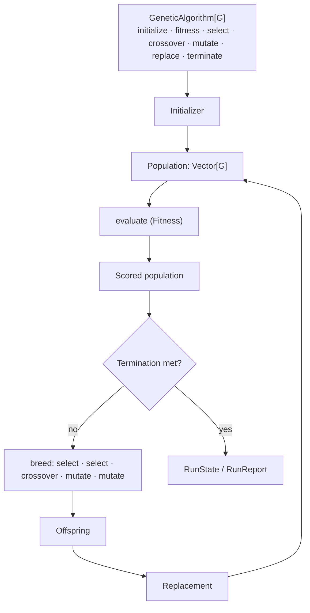
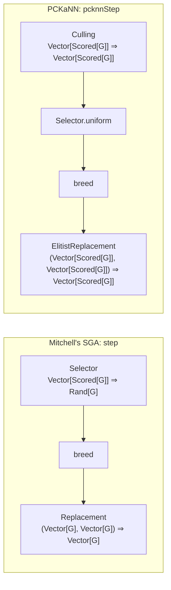
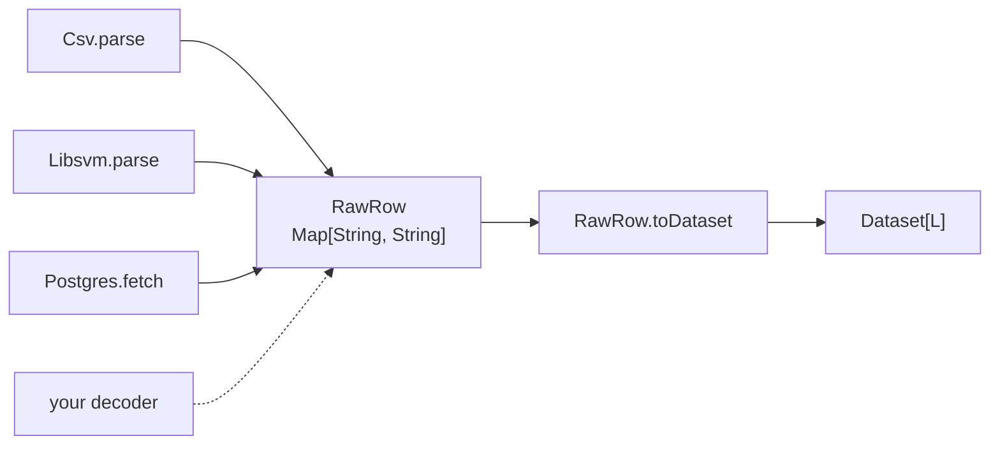
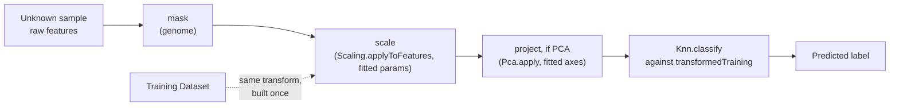

# sga

**[Try the live demo](pathname:///sga/demo/)**: sga's own code, compiled to JavaScript, choosing features in your browser on Iris, Wine, Glass, QSAR or generated data, a generation or a pair at a time. **[API reference](pathname:///sga/api/index.html)** · **[GitHub](https://github.com/TJMSolns/sga)**

A simple genetic algorithm, built as a functional meta-algorithm. The evolutionary loop is the
reusable part. Everything that gives one run its meaning (the genome representation, fitness,
selection, crossover, mutation, replacement and termination) is a function you pass in, so the
engine never needs to know what a genome represents or what "fitness" means for your problem.

Scala 3 and Mill. Pure, immutable and synchronous: no effects library, because this is a
computation, not a service. The same seed always gives the same run.

It ships with feature selection for classification, and has been run against real chemistry
and classic datasets: olive oil, wine, gas sensors, Raman spectra, molecular descriptors, Iris.

## Results on real data

Each row is reproduced by a test suite in `sga/test`, run on every CI build.

| Dataset | Engine | Result | Score |
|---|---|---|---|
| Iris | Mitchell SGA (leave-one-out) | `petal_length` + `petal_width` | 0.9667 |
| Iris | PCKaNN reproduction pipeline | `petal_length` + `petal_width` | 0.886 |
| Iris | Prediction (30 held-out unknowns) | `petal_width` alone | 0.9 (27/30) |
| Iris | Multi-seed (8 seeds) | `petal_width` in 100% of runs | 0.9667 every seed |
| UCI gas sensor (128 features) | Mitchell SGA (90-sample subset) | 72/128 features | 0.867 |
| Olive oil (GC fatty-acid composition) | Mitchell SGA (90-sample subset) | `stearic`, `oleic`, `linolenic`, `eicosenoic` | 1.0 |
| Wine (wet-chemistry assay) | Mitchell SGA | 8/13 features | 0.983 (175/178) |
| Glass (elemental/XRF composition) | Mitchell SGA | 7/9 features | 0.804 (172/214, class imbalance) |
| QSAR Biodegradation (computed molecular descriptors) | Mitchell SGA (90-sample subset) | 20/41 descriptors | 0.9 (81/90) |
| RRUFF Raman (6 minerals, 241 wavenumber bins) | Mitchell SGA (60-sample subset) | 130/241 bins | 1.0 |
| Wine Quality, red (physicochemical assay, re-binned to 3 classes) | Mitchell SGA (120-sample subset) | 7/11 features | 0.767 (92/120, ordinal target) |
| Iris, versicolor vs. virginica | AdaBoost over a GA-selected stump pool | 71/172 candidate stumps | 100% held-out (20/20) |
| Iris | Boruta (20 rounds, injected noise column) | 4/4 real features Confirmed | noise: Tentative, not Confirmed |
| Iris | Hierarchical clustering (threshold 0.5) | `{sepal_length, petal_length, petal_width}` vs. `{sepal_width}` | n/a |
| Iris | mRMR vs. relevance-only (top 2) | the redundancy-penalized pair scores *worse* | 0.9533 vs. 0.96 |
| Iris | RFECV (best across the trajectory) | the full 4-feature set beats every smaller subset | 0.9667 |

**How to read the scores.** Unless a row says held-out, a score is leave-one-out accuracy on the
samples the search ran on (PCKaNN's row is its own fitness, a class-purity score, and the Boruta
and clustering rows report their own outcomes). Because the search keeps the best of many feature
sets scored on those same samples, these scores overstate accuracy on new data: the winner won
partly by chance, which is selection bias (Ambroise & McLachlan, 2002). The held-out rows are
measured on samples the search never saw.

*Mitchell SGA* is the Simple Genetic Algorithm as described by Melanie Mitchell in *An
Introduction to Genetic Algorithms*. *PCKaNN* is a feature-selection
genetic algorithm that scores each sample with k-nearest neighbors in principal-component space,
with its own culling and reproduction scheme, from Moores (1998) and Moores (2000), listed under
[References](#references). Both run on the same engine.

## Quick start

**Requirements:** JDK 17+, and [Mill](https://mill-build.com) (the version is pinned in
`.mill-version`). Mill fetches Scala itself.

```bash
mill sga.compile
mill sga.test
```

Some real-data suites take 15 to 30 seconds on their own. To run one suite:

```bash
mill sga.test.testOnly 'solutions.tjm.sga.IrisDemoSuite'
```

The Postgres tests need Docker. Without it they don't register, so they don't fail:

```bash
docker compose up -d          # postgres:16-alpine on localhost:5434
PGUSER=sga PGPASSWORD=sga mill sga.test
```

### As a library

Every demo in this repository has this shape:

```scala
import solutions.tjm.sga._
import solutions.tjm.sga.ml.{Classification, Distance}

val ga = GeneticAlgorithm[Vector[Boolean]](
  initialize = Initializer.randomBitPopulation(chromosomeLength = 4),
  fitness = Classification.fitness(k = 5, distance = Distance.euclidean)(myScaledDataset),
  select = Selector.rouletteSelection,
  crossover = Crossover.singlePointCrossover(pc = 0.7),
  mutate = Mutation.bitwiseMutation(pm = 1.0 / 4),
  replace = Replacement.generationalReplacement,
  terminate = Termination.afterGenerations(maximum = 30)
)

val report = runWithReport(ga, populationSize = 20, seed = 42L)
// report.bestGenome, report.bestFitness, report.fitnessTrajectory
```

To see the engine solve a problem it was never built for, a travelling-salesman ordering
rather than a feature mask, read [`docs/write-your-own-problem.md`](./write-your-own-problem).

### From the command line

```bash
mill sga.runMain --mainClass solutions.tjm.sga.cli.Main \
  --data path/to/data.csv --features col1,col2,col3 --label species
# or: --format libsvm --feature-count 128, for libsvm data
```

(Leave out the `--` you might expect before the flags; it confuses Mill's own argument parsing.)

```
Generations run: 30
Best fitness: 0.9666666666666667
Selected features (2/4): petal_length, petal_width
```

| Flag | Default | Meaning |
|---|---|---|
| `--data` | *(required for `csv`/`libsvm`)* | Path to the data file; not used for `postgres` |
| `--format` | `csv` | `csv`, `libsvm`, or `postgres` |
| `--features` | *(required for `csv`/`postgres`)* | Comma-separated feature column names |
| `--label` | *(required for `csv`/`postgres`)* | Label column name |
| `--feature-count` | *(required for `libsvm`)* | Number of features per line |
| `--jdbc-url` | *(required for `postgres`)* | JDBC URL, with no embedded credentials |
| `--query` | *(required for `postgres`)* | A `SELECT` returning both feature and label columns |
| `--population` | `20` | GA population size |
| `--generations` | `30` | Generations to run |
| `--seed` | `42` | Random seed: same seed, same run |
| `--k` | `5` | k for k-nearest-neighbors |
| `--pc` | `0.7` | Crossover probability |

**Data formats.** `csv` expects a header row, and `--features`/`--label` must match its column
names exactly; quoted fields containing commas aren't supported. `libsvm` expects
`<class> <index>:<value> ...` on each line, with every declared feature present (true sparse
libsvm isn't supported yet). `postgres` runs your `SELECT` and treats the result like a CSV.
Credentials come from the standard `PGUSER`/`PGPASSWORD` environment variables, the same ones
`psql` reads, never from the URL:

```bash
PGUSER=myuser PGPASSWORD=mypass mill sga.runMain --mainClass solutions.tjm.sga.cli.Main \
  --format postgres --jdbc-url jdbc:postgresql://localhost/mydb \
  --query "SELECT sepal_length, sepal_width, petal_length, petal_width, species FROM iris" \
  --features sepal_length,sepal_width,petal_length,petal_width --label species
```

On a large dataset the CLI warns, but doesn't refuse, when leave-one-out's O(n²) cost is likely
to make the run slow.

**Looking at a run.** [`visualize.html`](https://github.com/TJMSolns/sga/blob/main/visualize.html) is a standalone page (no build, no
server) that plots a run's fitness trajectory, selected features and principal-component scatter
from the JSON that `Cli.toJson` produces. It has a "Load a sample run" button. The CLI binary
itself still prints only the plain-text summary; a `--json` flag isn't built yet.

## How it's built

### The meta-algorithm

`GeneticAlgorithm[G]` is configuration. `run` is the one evolutionary loop, and it knows nothing
about what a genome is. The whole project is built around that split.



### Two reproduction pipelines

PCKaNN's `Culling` and `ElitistReplacement` have different types from Mitchell's `Selector` and
`Replacement`, not just different behavior, so PCKaNN gets its own step function rather than a
mode flag inside the loop.



### Data comes in through one seam

Any source becomes `Vector[RawRow]` through its own small decoder, and `RawRow.toDataset`, the
step that turns rows into a typed `Dataset`, never changes. CSV, libsvm and Postgres all arrive
this way. RRUFF Raman spectra have their own decoder plus resampling onto a fixed wavenumber grid,
and a spectrum that doesn't cover the grid is flagged, not padded or silently dropped.



### Prediction

`FittedModel.transform` is the one function used both to build the transformed training set and
to project an unknown sample at prediction time, so the two can't drift apart. Scaling and PCA
are fitted once and never re-fitted on new data.



## What's in the box

| Package | Contains |
|---|---|
| `solutions.tjm.sga` | The engine: `GeneticAlgorithm`/`PcknnAlgorithm`, `run`/`step` and their PCKaNN equivalents, `Selector`, `Crossover`, `Mutation`, `Replacement`, `Termination`, `Culling`, `ElitistReplacement`, `Rand`/`Rng`, `RunReport`, `MultiSeed` |
| `.linalg` | Dependency-free linear algebra: `Vec`, `Matrix`, `Eigen`, `Pca`, `Inversion` |
| `.data` | `Sample`, `Dataset`, `Scaling`, `Outliers`, `Mahalanobis`, `SpectralResampling`, `StratifiedSplit`, `Descriptive` |
| `.io` | `RawRow` (the seam), `Csv`, `Libsvm`, `Postgres`, `Rruff` |
| `.ml` | `Knn`, `Distance`, `Classification`, `Pcknn`, `FittedModel`/`predict`, `NaiveBayes`, `LogisticRegression`, `AdaBoost`/`Stump`, `RandomForest`, `Boruta`, `HierarchicalClustering`, `Mrmr`, `Rfecv`, `ClassMetrics`, `Visualization` |
| `.cli` | `Cli`, `CliArgs`, `Main` |

A few things worth knowing about:

- **The ensembles reuse the engine unchanged.** In `AdaBoost` and `RandomForest` the genome
  chooses which weak learners to use, not which features, and `evolve` doesn't change at all.
  On Iris, boosting beat bagging, 100% to 85% held-out accuracy.
- **Run reporting keeps the best ever, not just the last generation,** and `multiSeedRun` reports
  how often each feature is selected across seeds.
- **`Rand` is a lawful state monad,** with property tests for the functor and monad laws.
  Structural invariants (crossover preserves genome length, selection preserves population size)
  are property-tested too.
- **Outlier marking comes in two kinds:** `Outliers` assumes independent features, and
  `Mahalanobis` accounts for correlation. Neither is a strict upgrade on the other. Both flag;
  neither deletes.
- **Non-GA feature selection** (`Boruta`, `Mrmr`, `HierarchicalClustering`, `Rfecv`) is built
  from the same pieces, for comparison against the GA.
- **`bruteForceSelect`** checks the GA against the true optimum when the search space is small
  enough to enumerate. On Iris, the GA's best is the true optimum.

## Limitations

- Leave-one-out costs O(n²) in the number of samples. The CLI warns about it; it doesn't fix it.
- Classification only, no regression.
- AdaBoost handles binary labels only.
- There is no secrets-handling story in the `io` layer beyond the standard Postgres environment
  variables, which any warehouse-style source would need first.

What's planned next is in [`ROADMAP.md`](https://github.com/TJMSolns/sga/blob/master/ROADMAP.md), and what changed in each release is in
[`CHANGELOG.md`](https://github.com/TJMSolns/sga/blob/master/CHANGELOG.md).

## Documentation

- [`docs/write-your-own-problem.md`](./write-your-own-problem): a worked, tested walkthrough
  on a problem the engine has never seen.
- [`docs/domain-model.md`](./domain-model): every core term defined against the code,
  and the look-alike terms that must not merge.
- [`docs/comparison.md`](./comparison): how `sga` differs from Jenetics and mgo, based on
  their public documentation.
- [`docs/cli-bdd-scenarios.md`](https://github.com/TJMSolns/sga/blob/master/docs/cli-bdd-scenarios.md): the CLI's behavior as Gherkin
  scenarios, checked against the running binary.
- [`docs/operator-panel-bdd-scenarios.md`](https://github.com/TJMSolns/sga/blob/master/docs/operator-panel-bdd-scenarios.md): scenarios for
  an operator panel that isn't built yet.
- [`docs/platform-capabilities.md`](https://github.com/TJMSolns/sga/blob/master/docs/platform-capabilities.md): the two environmental
  capabilities the code depends on (reading files, and Postgres), and their portability status.
- [`io-spikes.md`](https://github.com/TJMSolns/sga/blob/master/io-spikes.md): design spikes showing the `RawRow` seam holds for XLSX, REST,
  Snowflake, BigQuery and S3/Parquet sources.
- [`ml-mfa-spikes.md`](https://github.com/TJMSolns/sga/blob/master/ml-mfa-spikes.md): feasibility spikes for the non-GA feature-selection
  techniques, including why there's no SHAP (a licensing wall).
- [`FAQ.md`](./faq), [`CONTRIBUTING.md`](https://github.com/TJMSolns/sga/blob/master/CONTRIBUTING.md), [`SECURITY.md`](https://github.com/TJMSolns/sga/blob/master/SECURITY.md),
  [`CODE_OF_CONDUCT.md`](https://github.com/TJMSolns/sga/blob/master/CODE_OF_CONDUCT.md).

## References

- Ambroise, C. & McLachlan, G. J. (2002). Selection bias in gene extraction on the basis of
  microarray gene-expression data. *PNAS* 99(10), 6562–6566.
- Mitchell, M. (1996). *An Introduction to Genetic Algorithms*. MIT Press.
- Moores, A. (1998). *PCKaNN: A Feature Selecting Routine*. Department of Chemistry, Clarkson
  University, Potsdam, NY.
- Moores, A. (2000). *The Learning Genetic Algorithm: A Hybrid Learning System*. M.S. thesis,
  Computer Science, Clarkson University, Potsdam, NY.

In PCKaNN, feature count only broke ties between genomes of equal fitness; `sga` doesn't
replicate that detail (see [`FAQ.md`](./faq)). The design ideas behind the
engine are written up in [Great Martinis & Algorithms are DRY](https://www.tjm.solutions/articles/2026/08/16/great-martinis-and-algorithms-are-dry)
and [Name the Dragon](https://www.tjm.solutions/articles/2026/07/11/name-the-dragon).

## License

MIT, see [`LICENSE`](https://github.com/TJMSolns/sga/blob/master/LICENSE). That covers the code. The real-data test fixtures carry their own
terms, documented in each `*-LICENSE.md`:

- **`gas-sensor`**: research use only; commercial use is prohibited.
- **`olive-oil`**, **`rruff`**: open to use, but neither source states a definite license for
  the data itself, so treat them as weaker than the CC BY sources below.
- **`wine`**, **`glass`**, **`qsar-biodeg`**, **`wine-quality`**: CC BY 4.0 (UCI). Attribution
  required; commercial use permitted.

Dependencies: `org.postgresql:postgresql` at runtime (PostgreSQL License), and
`org.scalameta::munit` and `munit-scalacheck` for tests (BSD-3-Clause). All are compatible with MIT.
